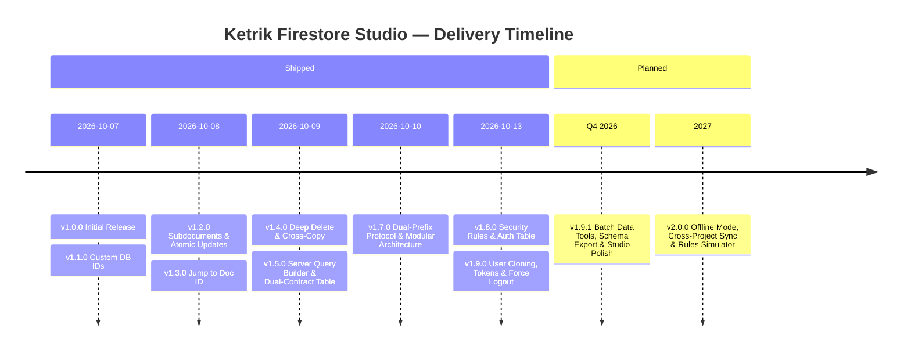

# Ketrik Firestore Studio — Product Roadmap & Release Schedule

This document outlines the version milestones, historical release dates, and strategic roadmap for **Ketrik Firestore Studio**.

---

## 📅 Release History & Milestones

| Version | Status | Release Date | Key Focus Areas |
| :--- | :--- | :--- | :--- |
| **v1.0.0** | Shipped | 2026-10-07 | Multi-connection explorer, virtual JSON editor, basic collection tables |
| **v1.1.0** | Shipped | 2026-10-07 | Named custom database IDs (`(default)` and custom instances), UI badges |
| **v1.1.1** | Shipped | 2026-10-07 | Paging offset fixes, gRPC connection handling |
| **v1.2.0** | Shipped | 2026-10-08 | Root variables as virtual subdocuments, atomic partial updates, tree fields |
| **v1.2.1** | Shipped | 2026-10-08 | Modal QuickPick for booleans/numbers/strings, tree sync fixes |
| **v1.3.0** | Shipped | 2026-10-08 | Direct 1-read document ID jump (Tree & Table views), quota protection |
| **v1.4.0** | Shipped | 2026-10-09 | Deep recursive delete, duplicate doc, cross-connection copy/paste, memory cleanups |
| **v1.5.0** | Shipped | 2026-10-09 | Server-side query builder (multi-clause `where`), Map/Array field table view (`openFieldAsTable`), atomic field rename, granular refresh |
| **v1.7.0** | Shipped | 2026-10-10 | Dual-Prefix protocol (`_` & `__`), Tree hierarchy badging, Table column zones & noise toggles, protocol query presets, safe mode mutation guards, cross-substrate paste, modular extension architecture |
| **v1.8.0** | Shipped | 2026-10-13 | Live Security Rules inspector & diff (`firestore.rules`), TextMate syntax grammar, AST rule permissions parser, Firebase Auth users tree & table view (bulk load, newest-first sort, custom claims editor, profile linker), sticky table columns (pinned ID & actions) |
| **v1.9.0** | Shipped | 2026-10-13 | Cross-environment user cloning (`cloneAuthUser`), custom token minter (`mintCustomToken` / login as user), session revocation (`revokeUserSessions` / force logout), password reset link generator, cascade profile deletion, user avatar photos in table, clean icon-only rule badges |
| **v1.9.1** | Planned | Q4 2026 | Pre-2.0 Bridge: Bulk batch operations (batch mutate/delete), TypeScript contract & schema generator, CSV/JSON collection import & export wizard, collection count aggregation, query bookmarks & history |
| **v2.0.0** | Future | 2027 | Local offline cache & sync, cross-database schema diffing, interactive visual Security Rules simulator & test runner, multi-tab studio dashboard |

---

## 🚀 Active & Upcoming Releases

### [v1.9.0] — User Cloning, Token Minter & Session Control (Shipped: 2026-10-13)

*Theme: Cross-environment user migration, impersonation token minting, and clean tree ergonomics.*

* **Cross-Environment Auth User Cloning (`ketrik-firestore-studio.cloneAuthUser`)**:
  * Clone any user account directly across connections (e.g. *Production $\rightarrow$ Staging* or *Local Emulator*).
  * Copies account metadata (`uid`, `email`, `displayName`, `photoURL`, `phoneNumber`, `disabled`, `emailVerified`) and custom claims.
  * Option to simultaneously clone their associated Firestore profile document (`/users/{uid}`).
  * Automatically copies a freshly generated password reset link for the target environment to the clipboard.
* **Custom Auth Token Minter (`ketrik-firestore-studio.mintCustomToken`)**:
  * 1-click minting of signed custom JWT auth tokens for any user (`auth.createCustomToken(uid)`).
  * Enables instant login as any user in client frontends or REST testing to verify security rules and app permissions.
* **Session Revocation / Force Logout (`ketrik-firestore-studio.revokeUserSessions`)**:
  * Immediately revokes all active refresh tokens for an account across all sessions and devices.
* **Password Reset Link Generator (`ketrik-firestore-studio.resetAuthUserPassword`)**:
  * Generates secure out-of-band password reset links directly from tree context menus or table rows, copied straight to clipboard with optional browser jump.
* **Cascade User & Profile Deletion (`ketrik-firestore-studio.deleteAuthUser`)**:
  * Delete an Auth user with intelligent prompt to also delete their `/users/{uid}` Firestore profile document.
* **Avatar & Photo Display in Auth Users Table**:
  * Renders user profile avatars (`photoURL`) with automated fallback to stylized user initial badges.
* **Ergonomic Icon-Only Security Badges**:
  * Replaced bulky text badges in the tree view with minimal single-character status icons (`🚨`, `⚠️ 🌐`, `👤`, `🛡️`, `🔑`, `🔒`), preserving full readable analysis inside hover tooltips.

---

### [v1.8.0] — Security Rules & Auth User Management (Shipped: 2026-10-13)

*Theme: Project governance, security rules diffing, enterprise user claims, and high-density tabular browsing.*

* **Live Security Rules Inspector & Diff (`firestore.rules`)**:
  * Direct extraction of live deployed rules via Firebase Rules API (`firebase.securityRules.get`).
  * Virtual editor tab (`ketrik-firestore-studio://rules/firestore.rules`) with `.rules` syntax highlighting.
  * Side-by-side graphical diff between deployed cloud rules and local workspace `firestore.rules`.
  * Quick deployment command with safety confirmation.
  * AST permission analysis highlighting locked vs authenticated collections.
* **Firebase Authentication & User Management Suite**:
  * Dedicated **Authentication (Users & Claims)** tree node under each connection.
  * Tree paging (25 users/batch) with `Load more users...` cursor pagination.
  * **Auth Users Webview Table**:
    * Bulk loading up to 1,000 users per single HTTP request (zero Firestore read billing).
    * Instant in-memory sorting by **Creation Date (Newest First)**, **Last Sign-in**, and **Email / Name**.
    * Real-time client-side filter by email, UID, display name, and custom claims.
    * In-table actions: Edit Custom Claims (`admin`, roles), Check/Create Firestore Profile (`users/{uid}`), and Disable/Enable user.
    * Export loaded/filtered users to JSON.
* **Sticky Column Table Navigation**:
  * Sticky left-pinned identifier columns (`Document ID`, `Email / Name`, `Row ID`) during horizontal scroll.
  * Sticky right-pinned `Actions` column on Auth Users Table.
  * Sticky column headers on vertical scroll.

---

### [v1.9.0] — Batch Operations, Schema Generator & Studio Polish (Target: Q4 2026)

*Theme: Final polish and developer productivity bridge before the v2.0 major milestone.*

* **Cross-Environment Auth User Cloning (`Clone / Copy User to Connection...`)**:
  * Right-click any Auth user or select in Table view $\rightarrow$ **Clone User to Connection...**.
  * Replicates user account (`uid`, `email`, `displayName`, `photoURL`, `customClaims`, `emailVerified`) to target environment (e.g., Production $\rightarrow$ Staging or Local Emulator).
  * Optional checkbox to cascade-clone their Firestore profile document (`/users/{uid}`) in the same operation.
  * Option to generate a fresh password reset link on the target connection.
* **Bulk Batch Mutation & Deletion**:
  * Multi-select rows in Collection Table or Auth Users Table.
  * Batch field update (e.g., set `status: "archived"` across 50 selected documents via `WriteBatch`).
  * Batched delete with quota warning and dry-run preview.
* **TypeScript Contract & Schema Generator**:
  * Right-click any collection or document $\rightarrow$ **Generate TypeScript Interfaces**.
  * Introspects documents in the collection to deduce inferred TypeScript types (including optional fields and nested structures).
  * Direct copy or write to `.d.ts` file in the workspace.
* **Data Import & Export Wizard (CSV & JSON)**:
  * Import CSV or JSON datasets directly into a Firestore collection with custom ID mapping and field type coercion.
  * Full collection export to JSON / NDJSON / CSV with streaming batching to avoid memory exhaustion.
* **Firestore Aggregation Queries**:
  * Native Firestore `count()`, `sum()`, and `average()` aggregation support in the Table view header (showing exact collection document counts at minimal read cost).
* **Project Auth Configuration Inspector**:
  * Dedicated inspector for `admin.auth().projectConfigManager()`: view enabled sign-in providers, authorized domains list with 1-click addition, SMS region policies, and blocking functions (`beforeSignIn`, `beforeCreate`).
* **Query Bookmarks & Search History**:
  * Save frequently used server-side `where` query combinations as named bookmarks per collection.
  * Quick-access recent queries list.

---

### [v2.0.0] — Enterprise Studio & Offline Experience (Target: 2027)

*Theme: Next-generation enterprise workflow, offline emulation, and cross-project sync.*

* **Local Offline Cache & Mocking**:
  * Work offline with local SQLite/IndexedDB caches of remote documents with automatic drift detection and push synchronization.
* **Cross-Project Schema & Data Diff Viewer**:
  * Side-by-side graphical diff between environments (e.g. comparing Production vs. Staging collections or document structures).
* **Interactive Security Rules Simulator & Test Runner**:
  * In-IDE simulation engine to test rules against mock request auth tokens (`request.auth.uid`, `request.auth.token.admin`) before deploying.
* **Impersonation Token Minter (`Mint Custom Token & Sign-In Link`)**:
  * Generate minted custom JWT tokens for any user to test client apps and verify security rules permissions directly from that user's perspective.
* **Multi-Tab Studio Dashboard**:
  * Unified workspace tab with tabs for Collections, Auth Users, Rules, and Metrics.

