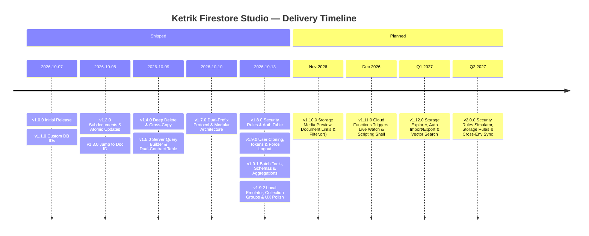

# Ketrik Firestore Studio — Product Roadmap & Release Schedule

This document outlines the version milestones, historical release dates, and strategic roadmap for **Ketrik Firestore Studio**.

---

## 📅 Release History & Milestones

| Version | Status | Release Date | Key Focus Areas |
| :--- | :--- | :--- | :--- |
| **v1.0.0** | Shipped | 2026-10-07 | Multi-connection explorer, virtual JSON editor, basic collection tables |
| **v1.1.0** | Shipped | 2026-10-07 | Named custom database IDs (`(default)` and custom instances), UI badges |
| **v1.1.1** | Shipped | 2026-10-07 | Paging offset fixes, gRPC connection handling |
| **v1.2.0** | Shipped | 2026-10-08 | Root variables as virtual subdocuments, atomic partial updates, tree fields |
| **v1.2.1** | Shipped | 2026-10-08 | Modal QuickPick for booleans/numbers/strings, tree sync fixes |
| **v1.3.0** | Shipped | 2026-10-08 | Direct 1-read document ID jump (Tree & Table views), quota protection |
| **v1.4.0** | Shipped | 2026-10-09 | Deep recursive delete, duplicate doc, cross-connection copy/paste, memory cleanups |
| **v1.5.0** | Shipped | 2026-10-09 | Server-side query builder (multi-clause `where`), Map/Array field table view (`openFieldAsTable`), atomic field rename, granular refresh |
| **v1.7.0** | Shipped | 2026-10-10 | Dual-Prefix protocol (`_` & `__`), Tree hierarchy badging, Table column zones & noise toggles, protocol query presets, safe mode mutation guards, cross-substrate paste, modular extension architecture |
| **v1.8.0** | Shipped | 2026-10-13 | Live Security Rules inspector & diff (`firestore.rules`), TextMate syntax grammar, AST rule permissions parser, Firebase Auth users tree & table view (bulk load, newest-first sort, custom claims editor, profile linker), sticky table columns (pinned ID & actions) |
| **v1.9.0** | Shipped | 2026-10-13 | Cross-environment user cloning (`cloneAuthUser`), custom token minter (`mintCustomToken` / login as user), session revocation (`revokeUserSessions` / force logout), password reset link generator, cascade profile deletion, user avatar photos in table, clean icon-only rule badges |
| **v1.9.1** | Shipped | 2026-10-13 | Batch operations (`WriteBatch` update/delete), TypeScript contract & Zod generator, CSV/JSON/NDJSON import & export wizard, collection `count()`/`sum()`/`avg()` aggregations, query bookmarks & history, create user dialog & auth security policies |
| **v1.9.2** | Shipped | 2026-10-13 | Local Firebase Emulator suite, collection group queries, inline table icons, aggregation QuickPick, rule caching |
| **v1.10.0** | Planned | Nov 2026 | Cloud Storage in-field media preview, DocumentReference jump & preview, disjunctive queries (`Filter.or()`), starts-with filter helper |
| **v1.11.0** | Planned | Dec 2026 | Cloud Functions trigger AST badging & simulation, live trigger logs filter, JS/TS Admin SDK query shell (`.firestore.ts`), live watch mode (`onSnapshot`), query explain profiler |
| **v1.12.0** | Planned | Q1 2027 | Dedicated Cloud Storage explorer (buckets/files), drag-and-drop upload to fields, cascade orphan file cleanup, Auth bulk import/export & email links, vector search (kNN) |
| **v2.0.0** | Future | Q2 2027 | Interactive Security Rules simulator & test runner, Cloud Storage security rules (`storage.rules`), cross-environment data & schema diff viewer, local offline cache & mocking |

---

## 🚀 Active & Upcoming Releases

### [v1.8.0] — Security Rules & Auth User Management (Shipped: 2026-10-13)

*Theme: Project governance, security rules diffing, enterprise user claims, and high-density tabular browsing.*

* **Live Security Rules Inspector & Diff (`firestore.rules`)**:
  * Direct extraction of live deployed rules via Firebase Rules API (`firebase.securityRules.get`).
  * Virtual editor tab (`ketrik-firestore-studio://rules/firestore.rules`) with `.rules` syntax highlighting.
  * Side-by-side graphical diff between deployed cloud rules and local workspace `firestore.rules`.
  * Quick deployment command with safety confirmation.
  * AST permission analysis highlighting locked vs authenticated collections.
* **Firebase Authentication & User Management Suite**:
  * Dedicated **Authentication (Users & Claims)** tree node under each connection.
  * Tree paging (25 users/batch) with `Load more users...` cursor pagination.
  * **Auth Users Webview Table**:
    * Bulk loading up to 1,000 users per single HTTP request (zero Firestore read billing).
    * Instant in-memory sorting by **Creation Date (Newest First)**, **Last Sign-in**, and **Email / Name**.
    * Real-time client-side filter by email, UID, display name, and custom claims.
    * In-table actions: Edit Custom Claims (`admin`, roles), Check/Create Firestore Profile (`users/{uid}`), and Disable/Enable user.
    * Export loaded/filtered users to JSON.
* **Sticky Column Table Navigation**:
  * Sticky left-pinned identifier columns (`Document ID`, `Email / Name`, `Row ID`) during horizontal scroll.
  * Sticky right-pinned `Actions` column on Auth Users Table.
  * Sticky column headers on vertical scroll.

---

### [v1.9.0] — User Cloning, Token Minter & Session Control (Shipped: 2026-10-13)

*Theme: Cross-environment user migration, impersonation token minting, and clean tree ergonomics.*

* **Cross-Environment Auth User Cloning (`ketrik-firestore-studio.cloneAuthUser`)**:
  * Clone any user account directly across connections (e.g. *Production $\rightarrow$ Staging* or *Local Emulator*).
  * Copies account metadata (`uid`, `email`, `displayName`, `photoURL`, `phoneNumber`, `disabled`, `emailVerified`) and custom claims.
  * Option to simultaneously clone their associated Firestore profile document (`/users/{uid}`).
  * Automatically copies a freshly generated password reset link for the target environment to the clipboard.
* **Custom Auth Token Minter (`ketrik-firestore-studio.mintCustomToken`)**:
  * 1-click minting of signed custom JWT auth tokens for any user (`auth.createCustomToken(uid)`).
  * Enables instant login as any user in client frontends or REST testing to verify security rules and app permissions.
* **Session Revocation / Force Logout (`ketrik-firestore-studio.revokeUserSessions`)**:
  * Immediately revokes all active refresh tokens for an account across all sessions and devices.
* **Password Reset Link Generator (`ketrik-firestore-studio.resetAuthUserPassword`)**:
  * Generates secure out-of-band password reset links directly from tree context menus or table rows, copied straight to clipboard with optional browser jump.
* **Cascade User & Profile Deletion (`ketrik-firestore-studio.deleteAuthUser`)**:
  * Delete an Auth user with intelligent prompt to also delete their `/users/{uid}` Firestore profile document.
* **Avatar & Photo Display in Auth Users Table**:
  * Renders user profile avatars (`photoURL`) with automated fallback to stylized user initial badges.
* **Ergonomic Icon-Only Security Badges**:
  * Replaced bulky text badges in the tree view with minimal single-character status icons (`🚨`, `⚠️ 🌐`, `👤`, `🛡️`, `🔑`, `🔒`), preserving full readable analysis inside hover tooltips.

---

### [v1.9.1] — Data Power Tools, TypeScript Schema & Aggregations (Shipped: 2026-10-13)

*Theme: Eliminating repetitive data wrangling, adding native Firestore count/sum aggregations, and giving TypeScript developers instant type definitions.*

* **Multi-Document Batch Operations in Table View (`WriteBatch`)**:
  * Multi-select rows in Collection Table via sticky checkbox column.
  * Batch field update (update a single field, atomic `FieldValue.delete()`, or merge JSON payload across selected documents via chunked `WriteBatch`).
  * Batched delete with confirmation modal showing count of affected documents, total write operations, and safety confirmation.
* **Native Firestore Aggregations (`count()`, `sum()`, `avg()`)**:
  * Native Firestore `count()`, `sum()`, and `avg()` aggregation support in the Table view header.
  * Instant collection document count at ultra-low cost (1 read per 1,000 index entries) without downloading document bodies.
  * Calculate field sum and average directly from server aggregation on demand.
* **Intelligent TypeScript Interface & Zod Schema Generator**:
  * Right-click any collection or document $\rightarrow$ **Generate TypeScript / Zod Schema...**.
  * Introspects and samples $N$ documents (10–50), deducing merged keys, optional fields (`?`), union types, and converting Firestore types (`Timestamp`, `GeoPoint`, `DocumentReference`).
  * Generates pure TypeScript interfaces (`interface UserDoc { ... }`) or Zod schemas (`z.object({ ... })`).
  * Direct copy to clipboard, open in new editor, or write to `.d.ts` / `.ts` file in the workspace.
* **Data Import & Export Wizard (CSV, JSON & NDJSON)**:
  * Import CSV, JSON, or NDJSON datasets directly into a Firestore collection with custom document ID strategy (Auto-ID, specific property, or row index) and automated type coercion (ISO dates $\rightarrow$ Timestamps, numbers, booleans).
  * Chunked streaming via `WriteBatch` (400 writes/batch) with live progress bar and cancellation controls.
  * Full collection export to JSON, NDJSON, or CSV with progress reporting.
* **Query Bookmarks & Search History**:
  * Save frequently used server-side `where` query combinations as named bookmarks per collection.
  * Stored in workspace configuration (`.vscode/firestore-queries.json`) for team sharing via Git.
  * Quick-access saved queries dropdown list in the table toolbar.
* **Firebase Auth Suite Enhancements**:
  * Create Auth User Dialog (`ketrik-firestore-studio.createAuthUser`): scaffold new user accounts directly in VS Code (email, password, displayName, custom claims).
  * Project Auth Security & Policies inspector (`ketrik-firestore-studio.inspectProjectAuthConfig`): inspect password policies, email privacy protection, MFA factor IDs, and SMS region policies.

---

### [v1.9.2] — Local Emulator Suite, Collection Groups & UI/UX Polish (Shipped: 2026-10-13)

*Theme: Frictionless local development, cross-hierarchy querying, ergonomic table actions, and rendering stability.*

* **Workspace & Local Emulator Auto-Discovery & Integrated Launcher**:
  * Automatically parse workspace `firebase.json` and `.firebaserc` to detect projects and configured emulators (Firestore `8080`, Auth `9099`, UI `4000`).
  * Non-blocking socket port health probing (`net.Socket`) with live status bar indicator (`$(server-process) Emulator: 8080 (Online)`).
  * 1-Click integrated terminal launcher (`firebase emulators:start`) with active port polling, timeout protection, and automatic connection provisioning.
  * Interactive QuickPick status menu (`ketrik-firestore-studio.emulatorStatusMenu`): Start, Stop, Restart, Connect, Open Emulator UI, and Re-scan.
  * Cross-substrate Auth emulator integration (`FIREBASE_AUTH_EMULATOR_HOST`) keeping production and emulator connections cleanly isolated.
  * Welcome view quick-action to boot or connect local emulators when no connections are present.
* **Collection Group Queries (`collectionGroup`)**:
  * Dedicated "Query Collection Group..." command (`ketrik-firestore-studio.queryCollectionGroup`) on connection, collection context menus, and Command Palette.
  * Partition-wide `firestore.collectionGroup(id)` querying flattening all subcollections across the database into a single tabular view.
  * Sticky **Parent Document** column (`__parentPath`) displaying origin document hierarchy with 1-click jump to open parent documents in VS Code.
  * Full server-side `where` filtering, sorting, cursor-based `startAfter` paging, batch operations (`WriteBatch`), and native `count()`/`sum()`/`avg()` aggregations.
  * Composite index error catcher with 1-click jump to Firebase Console index builder when queries require a collection-group-scoped index.
* **Inline Table View Action Icons in Tree Explorer**:
  * Inline `$(table)` action icon on collections for instant 1-click table view opening.
  * Inline `$(table)` action icon on Map and Array document fields (`openFieldAsTable`).
* **Smart Aggregations & Numeric QuickPick**:
  * `calcAggBtn` (`∑ Aggregates...`) only appears when numeric fields are detected in the loaded documents.
  * Interactive QuickPick automatically lists all detected numeric fields with custom path fallback.
  * Responsive loading (`⏳ Calculating...`) and error recovery states on the aggregation button.
* **Security Rules AST Caching & Safe Fallback**:
  * In-memory cache for parsed AST security rules (`RulesParser.ts`) eliminating redundant evaluation latency.
  * Graceful handling when no rules file is downloaded or configured, preventing misleading locked/restricted badges.
* **Table View Reliability & UX Polish**:
  * Fixed initial blank collection table view with recursive `sanitizeFirestoreValue()` and client script compatibility.
  * Fixed sticky column hover opacity bleed-through using opaque themed backgrounds.
  * Contextual toolbar buttons (`__ Protocol`, `_ Envelope`, `Simulate Time`) and clean empty state view.

---

### [v1.10.0] — Storage Media Preview, Document Links & Advanced Filters (Target: November 2026)

*Theme: Rich media inspection, relational graph navigation, and advanced query composition.*

* **Cloud Storage In-Field Media Preview**:
  * Automatic detection of Storage download URLs (`https://firebasestorage.googleapis.com/...`) and `gs://` paths in table cells and document JSON.
  * Interactive image thumbnails with hover-zoom, audio waveform playback, video preview, and PDF badge.
* **DocumentReference Interactive Navigation**:
  * Visual badge for `DocumentReference` fields in table view and tree view with clickable jump to open target document.
  * Preview hover tooltip showing referenced document excerpt without opening.
* **Disjunctive Queries (`Filter.or()` and `Filter.and()`)**:
  * Multi-group query builder supporting `OR` logic between filter sets in the Table view.
* **Prefix / `starts-with` String Filter Helper**:
  * GUI operator compiling `starts-with "prefix"` to `>= "prefix" && < "prefix\uf8ff"`.

---

### [v1.11.0] — Cloud Functions Triggers, Live Watch & Scripting Shell (Target: December 2026)

*Theme: Backend trigger visibility, ad-hoc Admin SDK scripting, real-time event streaming, and performance profiling.*

* **Cloud Functions Trigger AST Scanner & In-Tree Badges (⚡)**:
  * Automatically scan workspace `functions/` directory for declared Firestore triggers (`onDocumentCreated`, `onDocumentUpdated`, `onDocumentDeleted`, `onDocumentWritten` in v2, and `onCreate`, `onUpdate`, etc. in v1).
  * Display an animated **Trigger Badge ⚡** on collection and document nodes with 1-click jump to function TypeScript source code.
* **Simulate Cloud Function Triggers on Document**:
  * Right-click any document $\rightarrow$ **"Simulate Cloud Function Trigger..."** (`onCreate`, `onUpdate`, `onDelete`).
  * Packages document snapshot into standard `CloudEvent` / `Change<DocumentSnapshot>` format and dispatches directly to local Firebase Functions Emulator (`http://localhost:5001`).
* **Live Cloud Function Execution Logs Filter**:
  * Right-click collection or document $\rightarrow$ stream GCP Cloud Logging or emulator logs filtered by target document or collection.
* **Interactive JS/TS Admin SDK Query Shell (`.firestore.ts`)**:
  * Scaffold a virtual scratchpad file with authenticated `db`, `auth`, `admin`, and `FieldValue` in scope.
  * Run ad-hoc migrations or queries with `Cmd+Enter` and output streaming to an in-editor terminal panel.
* **Live Watch Mode / Real-Time Event Feed (`onSnapshot`)**:
  * Live Sync toggle (`📡 Live Watch`) on Collection Tables and open document editors with animated mutation feedback (green flash for new, amber for updated, red for deleted).
  * Quota safety: auto-pause watchdog after 5 minutes of inactivity.
* **Query Performance Profiler & Index Auto-Fixer (`explain({ analyze: true })`)**:
  * Visual query plan displaying execution latency, index entries scanned, and billable reads.
  * 1-click extraction of missing composite index URLs directly into workspace `firestore.indexes.json`.

---

### [v1.12.0] — Storage Bucket Explorer, Auth Suite Expansion & Vector Search (Target: Q1 2027)

*Theme: Full Cloud Storage browsing, advanced Auth user migration, and vector embeddings.*

* **Dedicated Cloud Storage Explorer in Sidebar Tree**:
  * Dedicated **Cloud Storage** branch under each connection (`StorageBucketsBranchItem`): browse buckets, folders, files, MIME types, file sizes, and download URLs.
  * Drag-and-drop file upload into document fields (auto-uploads to bucket and writes resulting URL or `gs://` path).
  * Signed URL minter (`getSignedUrl`) with customizable expiry (15m, 1h, 24h).
  * Cascade orphan file cleanup prompt when deleting documents or Auth users.
* **Firebase Auth Suite Expansion**:
  * Email verification link (`generateEmailVerificationLink`) and passwordless sign-in link generators.
  * Bulk Auth user import/export wizard (JSON/CSV with SCRYPT, BCRYPT, PBKDF2 hash support).
  * Provider identity chips (`Google`, `GitHub`, `Apple`, `Phone`, `Password`, `Anonymous`) and provider-based filtering.
  * Enrolled Multi-Factor Authentication (MFA) second factors viewer.
* **Firestore Vector Search & Embeddings Explorer (kNN)**:
  * Dedicated column renderer for `VectorValue` fields showing dimension count and cosine magnitude preview.
  * Similarity search query builder: execute kNN queries (`findNearest`) with vector inputs, distance metric (`COSINE`, `EUCLIDEAN`, `DOT_PRODUCT`), and similarity scores per row.
* **Collection Schema Drift & Anomaly Analyzer**:
  * Scans collection sample to produce interactive visual health reports: field presence percentages, type consistency matrix, and orphan keys.

---

### [v2.0.0] — Security Rules Simulator, Storage Rules & Cross-Env Sync (Target: Q2 2027)

*Theme: True enterprise governance, multi-service security rules simulation, and cross-project promotion.*

* **Interactive Security Rules Simulator & Test Runner**:
  * In-IDE simulation engine to test rules against mock request auth tokens (`request.auth.uid`, `request.auth.token.role`) and mock resource payloads before deploying.
  * Line-by-line visual AST evaluation showing exact pass/fail boolean branches.
  * 1-Click export of simulation scenarios as `@firebase/rules-unit-testing` Jest/Mocha test files.
* **Cloud Storage Security Rules Inspector & Diff (`storage.rules`)**:
  * Live extraction via Firebase Rules API, syntax highlighting, and side-by-side graphical diff between deployed cloud rules and workspace `storage.rules`.
* **Cross-Environment Data & Schema Diff Viewer (Staging vs. Production)**:
  * Side-by-side graphical diff between connections (comparing collections, schemas, or specific config documents).
  * 1-Click selective promotion/sync of documents from Staging to Production with diff preview and confirmation.
* **Local Offline Cache & Mocking Mode (Zero-Quota Development)**:
  * Snapshot working sets to a local SQLite database for zero-cost offline development on flights/commutes without needing the Java Firebase Local Emulator.
  * Visual sync manager upon reconnecting with conflict resolution (Keep Remote, Overwrite, Merge).
* **Unified Multi-Tab Studio Dashboard**:
  * Unified workspace tab integrating Collections, Auth Users, Rules, Storage Buckets, and Metrics.

