# Ketrik Firestore Studio — Product Roadmap & Release Schedule

This document outlines the version milestones, historical release dates, and strategic roadmap for **Ketrik Firestore Studio**.

```mermaid
timeline
    title Ketrik Firestore Studio — Delivery Timeline
    section Shipped
        2026-10-07 : v1.0.0 Initial Release : v1.1.0 Custom DB IDs
        2026-10-08 : v1.2.0 Subdocuments & Atomic Updates : v1.3.0 Jump to Doc ID
        2026-10-09 : v1.4.0 Deep Delete & Cross-Copy : v1.5.0 Server Query Builder & Dual-Contract Table
        2026-10-10 : v1.7.0 Dual-Prefix Protocol & Modular Architecture
        2026-10-13 : v1.8.0 Security Rules & Auth Table : v1.9.0 User Cloning, Tokens & Force Logout : v1.9.1 Batch Tools, Schemas & Aggregations : v1.9.2 Local Emulator, Collection Groups & UX Polish
        2026-10-14 : v1.10.0 In-Table Editing Suite, 2-Column Inspector Drawer, Storage Media Preview & Filter.or() : v1.11.0 Local JSON Database, Mock Store, Bi-Directional Sync & Timestamp Inlay Hints
        2026-10-15 : v1.12.0 Firestore Indexes Suite, Synthetic Mock Data Generator, Live Watch Mode & 750KB High-Quota Alerts
        2026-10-16 : v1.12.1 Table Loading Fixes & Pre-Flight Cost Estimator : v1.12.2 Cost Simulator, Capacity Modeler & CPU/Memory Optimizations
        2026-10-17 : v1.13.0 Cloud Storage Explorer, Vector Search, Schema Drift Analyzer & Auth Expansion
        2026-10-19 : v1.14.0 Box & Node Data Graph Canvas, Auth Table Floating Menu, Tree Field Actions & Cost UX
        2026-10-20 : v1.15.0 Expandable Map Fields, Nested Property Mutations & Substrate Parity : v1.15.1 Field Table In-Place Editing, Row Mutations & Duplicate Field
        2026-10-22 : v1.16.0 Studio Overview Dashboard & Traffic Analytics Suite
        2026-10-23 : v1.17.0 Multi-Collection Batch Replication Suite, Nested Field Editor & Performance Polish
        2026-10-25 : v1.18.0 AI Scratchpad, Tree Collection Filter, Array Item Mutations & UX Overhaul
        2026-10-27 : v1.19.0 Google Secret Manager Suite, Field Secret Links & Enterprise Credentials
        2026-11-02 : v1.19.1 Document Table View, Field Table SSR Hydration & Reliability Fixes
        2026-11-06 : v1.19.2 Performance, Local JSON Parity & Bug Fixes
        2026-11-13 : v1.20.0 Database Configuration, Point-in-Time Recovery (PITR) & Time Travel
        2026-11-14 : v1.21.0 Bulk Field Transformer, Auto-Fix & Safety Shields
    section Planned
        Q1 2027 : v1.22.0 Secret Manager Table View, Delete Secret, PII Masking & Query Explain
        Q2 2027 : v1.23.0 Schema Contract Linter & TTL Policies : v1.24.0 Universal Cross-Collection Search & AI Queries
        Q3 2027 : v2.0.0 Security Rules Simulator, Storage Rules & Cross-Env Sync
```

---

## 📅 Release History & Milestones

| Version | Status | Release Date | Key Focus Areas |
| :--- | :--- | :--- | :--- |
| **v1.0.0** | Shipped | 2026-10-07 | Multi-connection explorer, virtual JSON editor, basic collection tables |
| **v1.1.0** | Shipped | 2026-10-07 | Named custom database IDs (`(default)` and custom instances), UI badges |
| **v1.1.1** | Shipped | 2026-10-07 | Paging offset fixes, gRPC connection handling |
| **v1.2.0** | Shipped | 2026-10-08 | Root variables as virtual subdocuments, atomic partial updates, tree fields |
| **v1.2.1** | Shipped | 2026-10-08 | Modal QuickPick for booleans/numbers/strings, tree sync fixes |
| **v1.3.0** | Shipped | 2026-10-08 | Direct 1-read document ID jump (Tree & Table views), quota protection |
| **v1.4.0** | Shipped | 2026-10-09 | Deep recursive delete, duplicate doc, cross-connection copy/paste, memory cleanups |
| **v1.5.0** | Shipped | 2026-10-09 | Server-side query builder (multi-clause `where`), Map/Array field table view (`openFieldAsTable`), atomic field rename, granular refresh |
| **v1.7.0** | Shipped | 2026-10-10 | Dual-Prefix protocol (`_` & `__`), Tree hierarchy badging, Table column zones & noise toggles, protocol query presets, safe mode mutation guards, cross-substrate paste, modular extension architecture |
| **v1.8.0** | Shipped | 2026-10-13 | Live Security Rules inspector & diff (`firestore.rules`), TextMate syntax grammar, AST rule permissions parser, Firebase Auth users tree & table view (bulk load, newest-first sort, custom claims editor, profile linker), sticky table columns (pinned ID & actions) |
| **v1.9.0** | Shipped | 2026-10-13 | Cross-environment user cloning (`cloneAuthUser`), custom token minter (`mintCustomToken` / login as user), session revocation (`revokeUserSessions` / force logout), password reset link generator, cascade profile deletion, user avatar photos in table, clean icon-only rule badges |
| **v1.9.1** | Shipped | 2026-10-13 | Batch operations (`WriteBatch` update/delete), TypeScript contract & Zod generator, CSV/JSON/NDJSON import & export wizard, collection `count()`/`sum()`/`avg()` aggregations, query bookmarks & history, create user dialog & auth security policies |
| **v1.9.2** | Shipped | 2026-10-13 | Local Firebase Emulator suite, collection group queries, inline table icons, aggregation QuickPick, rule caching |
| **v1.10.0** | Shipped | 2026-10-14 | In-table spreadsheet editing suite (in-cell primitives, 2-column Key-Value Property Drawer for Maps/Arrays, atomic `FieldPath` updates), Bulk Field Deletion Checklist (`deleteMultipleFields`), inline hover trash icon (`$(trash)`), Cloud Storage media preview, DocumentReference jump, disjunctive queries (`Filter.or()`), starts-with operator |
| **v1.11.0** | Shipped | 2026-10-14 | Local JSON Database & Mock Store, cross-instance collection copy (`copyCollectionToInstance`), bi-directional sync (Push/Seed & Pull Snapshot), document storage size monitoring & status bar, timestamp formatting & inlay hints, table batch load controls (+50, +100, Load All 1K cap) & auto-replenish |
| **v1.12.0** | Shipped | 2026-10-15 | Firestore Composite Indexes Suite (tree inspector, firestore.indexes.json 2-way sync & auto-fixer), Synthetic Mock Data Generator (schema inference, 400 docs/batch), Real-Time Live Watch Mode (onSnapshot with animated flash feedback), 750KB High-Quota Warning Indicators |
| **v1.12.1** | Shipped | 2026-10-16 | Collection table loading fixes, Cost & Quota explorer tree item, unified Status Bar Cloud Monitoring metrics, query pre-flight cost estimator |
| **v1.12.2** | Shipped | 2026-10-16 | Interactive Cost Simulator dashboard, capacity modeling, comprehensive CPU & memory optimizations |
| **v1.13.0** | Shipped | 2026-10-17 | Cloud Storage Explorer, Vector Search (kNN), Collection Schema Drift & Anomaly Analyzer, Firebase Auth Expansion & Document Auto-Reveal |
| **v1.14.0** | Shipped | 2026-10-19 | Interactive Box & Node Data Graph Canvas, Auth Table Floating Menu (`⋯`), Document Tree Inline Field Actions, Responsive Cost & Quota UX |
| **v1.15.0** | Shipped | 2026-10-20 | Recursive expandable Map field nodes in Explorer Tree, context-aware nested property mutations, scoped multi-property deletions, field clipboard parity (Copy as JSON, nested dotted paths), arbitrary dot-delimited paths in virtual filesystem & Local JSON |
| **v1.15.1** | Shipped | 2026-10-20 | Field Table in-place spreadsheet cell editing, row entry addition & deletion, Duplicate Field command (`ketrik-firestore-studio.duplicateField`), and shared webview table styles |
| **v1.16.0** | Shipped | 2026-10-22 | Unified Studio Overview Dashboard, Database & User Insights, Network & Traffic Analytics Suite, Storage Footprint & Quota Burn Rate Gauges |
| **v1.17.0** | Shipped | 2026-10-23 | Multi-Collection Batch Replication Suite, Bulk Collection Deletion, Nested Field Virtual Editor, Tree Hierarchical Reveal, Overview Memory Optimization |
| **v1.18.0** | Shipped | 2026-10-25 | AI Scratchpad (.firestore/ hierarchy), Field-Level Isolation (Token Optimization), Live Auto-Sync, Tree Collection Filter, Expandable Tree Array Item Editing, Context Menu Tiers & Field Table Fixes |
| **v1.19.0** | Shipped | 2026-10-27 | Google Secret Manager Suite, Field Secret Links (`projects/.../secrets`), In-Place Payload Reveal, Version Lifecycle, Enterprise Credentials & Single Doc Cross-Instance Replication |
| **v1.19.1** | Shipped | 2026-11-02 | Interactive Document-as-Table webview (Property Sheet & Record view), Field Table SSR hydration, error handling & parsing fixes |
| **v1.19.2** | Shipped | 2026-11-06 | Memory/CPU optimizations, zero-allocation search, Local JSON table parity, array index safety & reliability fixes |
| **v1.20.0** | Shipped | 2026-11-13 | Firestore Database Configuration, Point-in-Time Recovery (PITR), Time-Travel Explorer (`readTime`), 7-Day Historical Diff & 1-Click Restore |
| **v1.21.0** | Shipped | 2026-11-14 | Collection Data Hygiene & Bulk Field Transformer (Type Casting, Backfills, Safe Batch Restructure), Schema Drift 1-Click Auto-Fix, Connection Read-Only Mode & Environment Badges (`PROD` / `STAGING` / `DEV`) |
| **v1.22.0** | Planned | Q1 2027 | Secret Manager Table View (100s of secrets) & Delete Secret (`deleteSecret`), PII Data Masking & Anonymization Engine, Firestore Query Explain (`EXPLAIN ANALYZE`) & Index Utilization Profiler |
| **v1.23.0** | Planned | Q2 2027 | Schema Contract Linter & Validator (TypeScript/Zod audit), Native Time-to-Live (TTL) Policy Inspector & GC Alerts |
| **v1.24.0** | Planned | Q2 2027 | Universal Cross-Collection Search (`Ctrl+Alt+F`), Natural Language AI Query Builder (`vscode.lm`) |
| **v2.0.0** | Future | Q3 2027 | Interactive Security Rules simulator & test runner, Cloud Storage security rules (`storage.rules`), cross-environment data & schema diff viewer |

---

## 🚀 Active & Upcoming Releases

> Detailed release specifications for v1.0.0 through v1.14.0 have been archived to keep this roadmap streamlined. See the milestone summary table above or git release tags for earlier history.

---

### [v1.15.0] — Expandable Map Fields, Nested Property Mutations & Clipboard Parity (Shipped: 2026-10-20)

*Theme: Recursive Map field tree hierarchy, context-aware nested property mutations, scoped batch property deletion, full JSON clipboard parity, and dot-path virtual filesystem resolution.*

* **Recursive Expandable Map Field Nodes in Explorer Tree**:
  * Complex Map fields (`{ n keys }`) with `keyCount > 0` are now first-class collapsible tree items (`vscode.TreeItemCollapsibleState.Collapsed`). Empty objects (`{}`) remain non-collapsible (`None`).
  * **Zero-Quota Browsing**: Expanding a Map field yields child `DocumentFieldItem` instances recursively without consuming any extra Firestore document reads (data is resolved in memory from the parent document snapshot).
  * **Two-Phase Click Behavior**: When collapsed, clicking expands the branch; once expanded, single-clicking opens the field in the virtual JSON editor tab (`ketrik-firestore-studio://.../docPath.json?field=address`).
  * **Parent Hierarchy Navigation**: Seamless tree reveal and `getParent` resolution back to the parent map or document node.
* **Context-Aware "Add Nested Property..." on Map Fields**:
  * Dedicated nested property creation command (`ketrik-firestore-studio.addNestedProperty`) targeting Map fields directly.
  * Inline `$(add)` quick action button on Map field tree rows and context menu action.
  * Prompts for new property name with input validation and full type picker (String, Number, Boolean, Timestamp, GeoPoint, Map, Array, Custom JSON).
  * Atomic Firestore writes via `docRef.update(new FieldPath(...targetSegments), value)` without touching sibling map keys.
* **Scoped "Delete Multiple Properties..." for Maps**:
  * Context-aware batch property deletion (`ketrik-firestore-studio.deleteMultipleFields`): when invoked on a Map field, scopes the QuickPick checklist strictly to the properties inside that specific map.
  * Safe Mode warnings and confirmation modal when system envelope (`_`) or protocol (`__`) keys are selected.
  * Multi-key atomic Firestore deletion using `FieldValue.delete()` across all selected nested paths in a single write operation.
* **Field Clipboard Parity ("Copy as JSON" & Nested Dotted Paths)**:
  * Dedicated **"Copy as JSON"** command (`ketrik-firestore-studio.copyFieldJson`) on all field context menus, copying clean formatted JSON representation of field values to the clipboard.
  * Enhanced **"Copy Path"** command (`ketrik-firestore-studio.copyPath`) to copy complete dot-delimited paths for nested fields (e.g. `users/123/address.street`) and enabled for all field types.
* **Arbitrary Dot-Delimited Path Support in Virtual File System & Local JSON**:
  * Enhanced `DocumentFileSystemProvider` (`getNestedFieldValue`): `stat`, `readFile`, baseline hash conflict detection, and `writeFile` now cleanly resolve and mutate arbitrarily nested property paths via `new FieldPath(...segments)`.
  * Enhanced `LocalJsonService` to support deep dotted path traversal and atomic mutations for offline JSON connections.

---

### [v1.15.1] — Field Table In-Place Editing, Row Mutations & Duplicate Field (Shipped: 2026-10-20)

*Theme: Spreadsheet in-place editing for Map/Array tables, row entry additions/deletions, and field duplication.*

* **Field Table In-Place Spreadsheet Editing**:
  * Double-click or Enter/F2 on scalar cells (strings, numbers, booleans, timestamps, nulls) in `openFieldAsTable` to edit values directly in place.
  * Type-safe inputs with boolean dropdowns, number validation, and optimistic `.flash-update` animation.
  * Atomic Firestore partial writes via `FieldPath(...segments, rowId, field)` for Maps and in-memory element replacement for Arrays with live `invalidateAndNotify` cache syncing.
* **Field Table Entry Addition (`➕ Add Entry`)**:
  * Dedicated toolbar action in Field Table to add new keyed properties to Maps or append elements to Arrays.
  * Interactive type picker (String, Number, Boolean, Timestamp, Object, Array, Custom JSON) with input validation.
* **Field Table Row Deletion (`🗑️ Delete Entry`)**:
  * Per-row action button (`🗑️`) with confirmation dialog.
  * Atomically deletes Map keys via `FieldValue.delete()` or splices Array elements by index.
* **Duplicate Field Command (`ketrik-firestore-studio.duplicateField`)**:
  * Right-click any field or nested property in the Explorer Tree to clone it under a new key.
  * Automatic collision checking, custom name prompt, and atomic write-back.

---

### [v1.16.0] — Studio Overview Dashboard & Traffic Analytics Suite (Shipped: 2026-10-22)

*Theme: Unified database & user insights, network traffic & throughput monitoring, and operational dashboards.*

* **Unified Studio Overview & Insights Dashboard (`ketrik-firestore-studio.openOverviewDashboard`)**:
  * **Database & Collection Breakdown**:
    * Total collection count, document counts via server-side `count()` aggregations, and estimated dataset storage volume.
    * Top 5 largest collections by document volume with 1-click jump to Table View.
  * **Network & Traffic Analytics Suite**:
    * **Throughput & Operations**: Interactive time-series charts showing hourly and 7-day/30-day reads, writes, and deletes.
    * **Bandwidth & Payload Size**: Sent bytes (egress) vs. received bytes (ingress) over time to spot oversized documents or query payload spikes (`firestore.googleapis.com/network/sent_bytes_count`).
    * **Real-Time Client Connections**: Active real-time listeners (`onSnapshot`) tracking client load (`firestore.googleapis.com/listen/realtime_connections_count`).
    * **Security Rule Traffic**: Allowed vs. Denied rule evaluation traffic ratio (`firestore.googleapis.com/rules/evaluation_count`).
    * **Multi-Source Fallback**: Automatically pulls from Google Cloud Monitoring API, Local Emulator telemetry ports, or active Studio session accounting with zero disruption.
  * **Firebase Auth & Growth Insights**:
    * Total registered users, 7-day sign-in frequency, and unverified vs. verified accounts.
    * Provider distribution breakdown (Email/Password, Google, Apple, Anonymous, Phone).
  * **Storage & Quota Gauges**:
    * Visual sparklines comparing current daily burn rate against Spark (Free) allowances and Blaze thresholds.

---

### [v1.17.0] — Multi-Collection Batch Replication Suite & Nested Field Polish (Shipped: 2026-10-23)

*Theme: Bulk multi-collection replication, selective migration wizard, deep subcollection hierarchy copying, nested document field virtual editor resolution, hierarchical tree reveal, and studio overview memory optimization.*

* **Multi-Collection Batch Replication Wizard (`ketrik-firestore-studio.copyMultipleCollections`)**:
  * Launch directly from any Connection or Collection context menu (`$(copy) Copy Multiple Collections to Instance...`) or Command Palette.
  * Interactive QuickPick checklist (`canPickMany: true`) with collection badges and individual checkboxes to selectively choose target collections.
  * Support for cross-instance migration (Production $\leftrightarrow$ Staging $\leftrightarrow$ Local Emulator $\leftrightarrow$ Local JSON) and intra-instance collection duplication.
* **Smart Naming & Prefix / Suffix Strategy**:
  * **Keep Identical Names**: Preserves collection names when replicating across distinct databases or emulators.
  * **Prefix / Suffix Rules**: Apply batch transformation patterns (e.g., `staging_`, `_backup`, `v2_`) or custom date stamps.
  * **Collision Protection**: Automatically enforces name mutations when duplicating within the same database to prevent self-overwrites.
* **Deep Recursive Subcollection Hierarchy Cloning**:
  * Choice between **Root Documents Only** (fast, quota-conscious) and **Deep Recursive Copy** (recursively walking and replicating nested subcollection trees).
  * Seamless cross-substrate translation across Firestore gRPC, Local Emulators, and Local JSON stores.
* **Type Fidelity & Chunked WriteBatch Safety**:
  * Preserves native Firestore types: `Timestamp`, `GeoPoint`, `DocumentReference`, byte arrays, and nested Map/Array objects.
  * Commits in safety chunks of 400 documents per `WriteBatch` (well below the 500-operation ceiling).
  * Live multi-collection progress reporting (`[2/5] Copying 'orders' (320/800 docs)... Overall: 42%`) with clean cancellation support at batch boundaries.
* **Automatic Cache Invalidation & Live Tree Sync**:
  * Emits `FileChangeType.Changed` via `DocumentFileSystemProvider.getInstance().invalidateAndNotify()` for all target collections, ensuring open virtual editors reload live without stale buffers.
  * Granular refresh of target explorer tree nodes.
* **Collection & Multi-Collection Permanent Deletion (`deleteCollection` & `deleteMultipleCollections`)**:
  * Right-click any collection $\rightarrow$ **`Delete Collection...`** (`$(trash)`).
  * Right-click any connection or collection $\rightarrow$ **`Delete Multiple Collections...`** to selectively delete multiple collections with checkboxes.
  * Recursive deletion across Cloud Firestore (`firestore.recursiveDelete`), Local Emulators, and Local JSON stores (`LocalJsonService.deleteCollection`).  
  * Safety modal confirmation with explicit warnings preventing accidental data loss.
* **Nested Document Field Virtual File System & Editor (`ketrik-firestore-studio.openFieldInEditor`)**:
  * Fixed virtual file URI resolution for nested Map properties (`sidebar_finance.options`): now maps to `ketrik-firestore-studio://<conn>/<docPath>/<fieldPath>.json` instead of wrongly truncating to the leaf field name.
  * `DocumentFileSystemProvider` parses dot-delimited field paths and resolves nested object hierarchies in both live Firestore and Local JSON modes without throwing `FileNotFound`.
  * Auto-dispatches `FileChangeType.Changed` events to open sub-field virtual JSON editor tabs when the parent document changes, ensuring open field tabs live-reload immediately.
  * Added URI fragment (`#fieldPath`) parsing support in virtual file system provider.
* **Hierarchical Tree Reveal for Nested Fields (`ExplorerDataProvider.revealDocument`)**:
  * Dot-notation path splitting (`targetSegments`) and iterative recursive traversal down nested Map structures.
  * Automatically expands and registers parent branches (`_expandedFieldIds`) so selecting or switching to nested field tabs expands and highlights the targeted field directly in the Explorer Tree.
* **Atomic Field Mutations Across All Contexts**:
  * Updated `tombstoneCommands`, `migrationCommands` (`explodeField`), and `documentCommands` (`pasteDocument`) to use `new FieldPath(...segments)` and `LocalJsonService` dot paths, ensuring safe atomic operations on deeply nested fields without key collisions.
* **Studio Overview & Analytics CPU/Memory Optimization**:
  * Added bounded LRU caching to `OverviewService` and `TrafficMetricsProvider` to eliminate memory retention during continuous polling.
  * Correct unref and disposal of background interval timers upon dashboard webview closure.

---

### [v1.18.0] — AI Scratchpad, Field-Level Isolation & Dual-Mode Architecture (Shipped: 2026-10-25)

*Theme: AI coding assistant optimization, LLM token reduction for 1MB documents, deterministic workspace scratchpads, and dual-mode architecture.*

* **Deterministic AI Scratchpads (`ketrik-firestore-studio.openAiScratchpad`)**:
  * 1-click zero-prompt scratchpad generation under `.firestore/<connectionId>/<collectionPath>/<docId>/[<fieldPath>.json]`.
  * Eliminates manual directory creation, file picking dialogs, and document ID collisions across different collections.
  * Automatically binds origin metadata in `.firestore/snapshots.json` and ensures `.firestore/` is gitignored.
* **Field-Level Isolation (Token Optimization for 1MB Documents)**:
  * Extract and isolate a single document field (e.g. `config.groups` or `sidebar_finance`) into its own scratchpad file.
  * Reduces AI LLM token consumption by up to 99.8% (e.g. 2 KB instead of 1 MB / ~250k tokens).
  * On save, pushes atomic partial updates via Firestore `FieldPath(...segments)` without re-uploading or risking the rest of the document.
* **Unpack Monolithic Document Fields (`ketrik-firestore-studio.unpackDocumentFields`)**:
  * 1-click unpack of all top-level keys in a document into individual modular files (`header.json`, `sidebar.json`, `metadata.json`), each independently tracked and auto-synced.
* **Dual-Mode Document Architecture (`ketrik-firestore-studio.openMode`)**:
  * `"virtual"` (default): 100% in-memory virtual tabs (`ketrik-firestore-studio://`) with zero files written to disk.
  * `"workspace"`: Directly opens `.firestore/...` scratchpad files on tree clicks for seamless 0-click AI assistant editing.
* **Live Automatic Synchronization (`ketrik-firestore-studio.autoSyncLocalSnapshots`)**:
  * When enabled, saving any tracked snapshot or scratchpad file immediately pushes changes back to Firestore or Local JSON.
* **Privacy & Scratchpad Cleanup (`ketrik-firestore-studio.cleanScratchpads`)**:
  * 1-click command in the Command Palette to recursively delete `.firestore/` and clear all bindings.
* **Side-by-Side Diffing, Push & Pull Suite**:
  * Dedicated toolbar and context menu actions for tracked files: `$(diff) Compare with Firestore`, `$(cloud-upload) Push to Firestore`, `$(cloud-download) Pull Latest from Firestore`.
* **AI Coding Assistant Virtual Path Resolution**:
  * Permanent rules registered in `AGENTS.md` and workflow skills to immediately recognize `/conn_...` as virtual Firestore Studio tabs and map them deterministically to `.firestore/` mirrors without wasting turns searching.
* **Interactive Collection Filter on Explorer Tree (`ketrik-firestore-studio.filterCollection`)**:
  * Filter any collection directly on the tree by Doc ID prefix or substring with inline `$(filter)` action, active badge indicator, and 1-click filter reset (`$(clear-all)`).
  * Fast early-exit recursive term matcher (`matchesSearchTerm`) that avoids full `JSON.stringify` allocations on large collections.
* **Expandable Array Tree Items & In-Place Item Mutations**:
  * Arrays on the tree are now collapsible and expandable into indexed individual elements (`[0]`, `[1]`, etc.).
  * Dedicated actions for Edit Array Item (`$(edit)`), Duplicate Array Item (`$(copy)`), Add Item to Array (`$(add)`), and Delete Array Item (`$(trash)`).
* **Tree Context Menu Overhaul & Logical Grouping Tiers**:
  * Restructured Explorer Tree context menus across Connections, Collections, Documents, Fields, and Array Items into logical tiers (`1_open`, `2_ai`, `3_edit`, `4_clipboard`, `5_tools`, `6_sync`, `7_refresh`, `9_danger`).
* **Field Table View Data Hydration & Sanitization (`openFieldAsTable`)**:
  * Embedded initial data directly into webview HTML (`window.__INITIAL_DATA__`) to eliminate `postMessage` race conditions.
  * Deep serialization and sanitization (`sanitizeFirestoreValue`) preventing complex/circular Firestore objects and timestamps from breaking webview structured cloning.
* **Deep CPU & Memory Optimization Suite**:
  * Zero-allocation `for..in` loops across document sizing, field items, table filtering, and schema analysis.
  * Shared zero-allocation `reviveTimestamps()` across all commands, sync services, and file system providers.
  * Precompiled function regexes and 500-item LRU bounds in `RulesParser.ts`.
  * Comprehensive disposable tracking for `OverviewService`, TTL timer cancellation in `DocumentFileSystemProvider`, and close listener leak fixes in `TimestampEditorDecorations.ts`.

---

### [v1.19.0] — Google Secret Manager Suite, Field Secret Links & Enterprise Credentials (Shipped: 2026-10-27)

*Theme: Enterprise Secret Management, Document Field Secret Bindings, Ephemeral Payload Inspection, and Zero-Plaintext Credential Security.*

* **Dedicated Google Secret Manager Tree Explorer (`🔐 Google Secret Manager`)**:
  * Dedicated top-level tree node under each GCP / Firebase connection.
  * Paged listing of all secrets in the project (`projects/{projectId}/secrets`) with filter and search.
  * In-tree badges indicating replication policy (Automatic / User-managed), active version count, and creation date.
  * Expandable secret nodes to browse individual versions (`v1 [Enabled]`, `v2 [Disabled]`, `v3 [Destroyed]`).
  * Secret metadata viewer displaying timestamps, labels, rotation schedule, and expiration dates.
* **Document Field Secret Linking & Smart Badging**:
  * **Automatic Secret Reference Detection**: Automatically detects fields containing Google Secret Manager resource paths (`projects/.../secrets/...` or Secret IDs) across the Explorer Tree, Table View, and JSON Editor.
  * **Visual In-Tree & In-Table Badges (`🔐`)**: Emits dedicated status badges with hover tooltips displaying secret name, version state, and replication info.
  * **1-Click "Link Field to Google Secret..." (`ketrik-firestore-studio.linkFieldToSecret`)**:
    * Right-click any document field in the tree or table $\rightarrow$ choose from an interactive QuickPick of existing secrets in the project.
    * Automatically writes the canonical secret resource name into the field with atomic mutation.
  * **1-Click "Migrate Field to Secret Manager" (`ketrik-firestore-studio.migrateFieldToSecret`)**:
    * Right-click any existing sensitive plaintext field (e.g. `api_key: "sk-live-..."`) $\rightarrow$ creates a new secret in GCP Secret Manager, uploads the value as version 1, and atomically replaces the plaintext field with the secure secret reference link.
  * **In-Place Ephemeral Secret Reveal & Clipboard Copy**:
    * Inline `$(eye) Reveal Secret Value` action to safely fetch and inspect the decrypted secret payload in a masked view without writing it to disk or document.
    * 1-Click copy secret value to clipboard with optional automated 15-second clipboard wipe timer.
* **Secret Version Lifecycle Management**:
  * Create new secrets directly from VS Code (`ketrik-firestore-studio.createSecret`).
  * Add new secret version payloads (`ketrik-firestore-studio.addSecretVersion`) via text input or file selection.
  * Disable, enable, and destroy versions with enterprise confirmation modals.
* **Zero-Plaintext Connection Credentials & VS Code SecretStorage**:
  * Load service account keys dynamically from Google Secret Manager (`secretUri: "projects/.../secrets/firestore-sa/versions/latest"`), eliminating plain `.json` credential files from developer workstations.
  * Native integration with VS Code encrypted OS Keychain (`vscode.SecretStorage` / `context.secrets`) to store credentials safely instead of saving sensitive tokens into `.vscode/settings.json`.
* **Firebase Emulator `.secret.local` & `.env` Mock Sync**:
  * 1-Click export / pull of referenced secrets into `.secret.local` or `.env.local` for the Firebase Functions Emulator and local offline development without manual copy-pasting.

---

### [v1.19.1] — Document Table View, Field Table SSR Hydration & Reliability (Shipped: 2026-11-02)

*Theme: Interactive single-document table representations, server-side rendered field tables, and error resilience.*

* **Interactive Document-as-Table Webview (`ketrik-firestore-studio.openDocumentAsTable`)**:
  * Dedicated command and UI entry points:
    * Inline action (`$(table)`) and context menu on document items in the Explorer Tree.
    * Editor title toolbar action on virtual JSON document tabs (`editor/title`).
    * Interactive path prompt from the command palette.
  * **Dual-View Layout**:
    * **Vertical Property Sheet (Fields View)**: Inspect all fields in a structured key-type-value view with inline cell editing, field type badges, and atomic property deletion.
    * **Horizontal Record View**: Single-row spreadsheet layout matching collection grid column semantics.
  * **Direct Breadcrumbs & Field Drill-Down**: 1-click jump to parent collection table (`openCollectionAsTable`) and nested field tables (`openFieldAsTable`) for Maps and Arrays.
  * **Atomic Partial Updates**: Double-click cell editing writes partial updates via `FieldPath` without rewriting or downloading the entire document.
* **Field Table View Initial Data Hydration & SSR (`openFieldAsTable`)**:
  * Pre-renders table headers and rows server-side (`renderHeaderRowHtml`, `renderRowsHtml`) directly into initial HTML, resolving client-side rendering race conditions on open.
  * Robust parsing for stringified JSON payloads and scalar fallback rows.
  * Webview-level error banner displays when snapshot retrieval or JSON parsing encounters an error.
* **Performance & Memory Optimization**:
  * Clean zero-allocation iterations in HTML generation routines and optimized type deduction.

---

### [v1.19.2] — Performance, Local JSON Parity & Reliability Fixes (Shipped: 2026-11-06)

*Theme: Substrate-level zero-allocation optimizations, full Local JSON table parity, and edge-case reliability.*

* **Zero-Allocation Search Substrate**: Replaced client-side stringified JSON filtering in table webviews with recursive tree matcher, eliminating GC pressure and input latency.
* **Explorer Tree Subfield Caching**: Granular caching for nested Map items with targeted branch invalidation on document mutations.
* **$O(1)$ Tabgroup Evaluation**: Pre-collects open virtual field editor tabs once during batch invalidations.
* **Live Reactive Table Sync**: Subscribed Document & Field Table webviews to virtual file system events with debounced live reload.
* **Resource Lifecycle**: Implemented disposable lifecycle for SecretManagerService and RAF-debounced graph canvas wheel zooming.
* **In-Cell Typing Preservation**: Preserved string types (`"true"`, `"false"`, `"null"`, numeric strings) across all table cell editors without unintended type coercion.
* **macOS Root Save Fix (`EROFS`)**: Centralized `getDefaultExportUri` across export dialogs to anchor saves to workspace folders instead of root `/`.
* **Local JSON Full Parity**: Added Local JSON support to collection table (`createDoc`, `jumpToId`, `openFieldAsTable`, `countCollection`, `estimateQueryCost`, `calculateAggregates`, batch updates/deletes).
* **Subcollection Path Safety**: Fixed subcollection path truncation in document & collection commands.
* **Array Index Protection**: Protected nested array indices from map conversion during field table updates.
* **Document Deletion Lifecycle**: Emitted `FileChangeType.Deleted` on document deletes so open virtual tabs close cleanly.
* **CostService Accounting**: Added operation tracking across batch replications, document pastes, and synthetic generation.

---

### [v1.20.0] — Firestore Database Configuration, Point-in-Time Recovery (PITR) & Time-Travel Suite (Shipped: 2026-11-13)

*Theme: Comprehensive database settings management, 1-click PITR activation, continuous 7-day disaster recovery, historical document diffing, accidental mutation rollback, and zero-loss restore workflows.*

* **Interactive Firestore Database Configuration View (`ketrik-firestore-studio.openDatabaseConfiguration`)**:
  * Dedicated settings inspector webview accessible via Connection context menu (`$(gear) Database Configuration & PITR Settings...`) or table toolbar.
  * **Editable Safety & Operational Controls**:
    * **Point-in-Time Recovery (PITR)**: View status, 7-day retention period, earliest available recovery timestamp (`earliestVersionTime`), and 1-click **Enable / Disable PITR** toggle.
    * **Delete Protection**: 1-click toggle (`DELETE_PROTECTION_ENABLED` / `DELETE_PROTECTION_DISABLED`) to shield production databases from accidental cloud deletion.
    * **Concurrency Mode**: Toggle between **Optimistic** (default for native Firestore) and **Pessimistic** locking concurrency control.
    * **App Engine Integration Mode**: Toggle integration enablement.
  * **Read-Only Infrastructure Metadata**:
    * Database ID, GCP Region / Multi-region (`locationId`, e.g. `nam5`, `us-central1`), Database Type (`FIRESTORE_NATIVE` vs `DATASTORE_MODE`), UID, Customer-Managed Encryption Keys (CMEK KMS Key Name), and creation/update timestamps.
  * **Local JSON & Emulator Support**:
    * For Local JSON: displays file path, disk size, active document counts, and in-memory cache health.
    * For Emulators: displays active emulator ports (Firestore, Auth, Storage), host, and project ID.
* **Native Point-in-Time Recovery (PITR) Engine (`readTime`)**:
  * Utilizes native Google Cloud Firestore PITR capability to query and inspect data at any microsecond in the past 7 days (`earliestVersionTime` to `now`).
  * Employs read-only transactions (`db.runTransaction(..., { readOnly: true, readTime: Timestamp })`) ensuring quota safety and atomic snapshot consistency.
  * Auto-detects database PITR status and `earliestVersionTime` with 1-click guidance to enable PITR via `gcloud` if disabled.
* **Interactive Time-Travel Explorer in Collection & Document Views**:
  * **Time-Travel Header Bar**: Direct controls inside the Collection Table and Document Table webviews:
    * Quick Presets: *15 minutes ago*, *1 hour ago*, *6 hours ago*, *24 hours ago*, *3 days ago*, *7 days ago*.
    * Custom Historical Picker: Interactive calendar & timestamp picker with microsecond precision.
    * Amber/Gold **"Historical Snapshot [readTime]"** mode indicator banner to prevent accidental confusion with live data.
* **Side-by-Side Historical Diff Viewer**:
  * 1-Click **"Compare with Current Live State"** (`$(diff)`): Opens a visual side-by-side diff between the historical document snapshot at `readTime` and the current live document in Firestore.
  * Highlights field additions, modifications, and deletions in color-coded JSON/table formats.
* **1-Click Accidental Mutation Rollback & Document Restore**:
  * **Restore Document from History (`ketrik-firestore-studio.restoreDocumentFromHistory`)**: Reverts the live document state back to the exact historical snapshot atomically via `docRef.set(historicalData)`.
  * **Deleted Document Recovery**: If a document was deleted in the live database, navigating to a timestamp before deletion detects the document with a `(deleted in live)` badge and provides a 1-click **"Restore Deleted Document"** action.
  * **Partial Field Reversion**: Restore individual fields or sub-objects from historical versions without overwriting the entire document.
* **Scheduled Backups & Restore Management**:
  * Dedicated **Backups & Recovery** tree node under each GCP / Firebase connection.
  * List existing Firestore automated backup schedules, retention policies, and available full database backups.
  * Trigger manual on-demand backup snapshots and view restore job progress directly in VS Code.

---

### [v1.21.0] — Collection Data Hygiene, Bulk Field Transformer & Safety Shields (Target: Q1 2027)

*Theme: Schema sanitation, batch type-casting, default backfills, 1-click auto-fix from Schema Drift Analyzer, connection-level read-only guards, and environment color shields.*

* **Bulk Field Transformation Wizard (`ketrik-firestore-studio.transformCollectionField`)**:
  * Launch from collection tree node or right-click any column in the Collection Table (`$(symbol-variable) Transform Field Across Collection...`).
  * **Type Casting Engine**:
    * String $\leftrightarrow$ Number (e.g. `"49.99"` $\rightarrow$ `49.99`).
    * String $\leftrightarrow$ Firestore Timestamp (e.g. ISO-8601 string $\rightarrow$ `Timestamp`).
    * Timestamp $\leftrightarrow$ String or Epoch Milliseconds.
    * Boolean string conversion (`"true"` / `"false"` $\rightarrow$ boolean `true` / `false`).
    * Scalar $\rightarrow$ Array wrapper (e.g. `tag` $\rightarrow$ `[tag]`).
  * **Backfill & Default Values**: Backfill missing or null fields across legacy documents with a specified default value or ServerTimestamp.
  * **Bulk Field Rename & Restructure**: Atomically rename a field or promote nested Map properties across 100% of documents in a collection.
  * **Bulk Field Deletion**: Purge deprecated or obsolete fields collection-wide with an audited batch action.
* **1-Click "Fix in Bulk Transformer" from Schema Drift Analyzer**:
  * Direct bridge from `openSchemaAnalyzer`: when type inconsistencies (e.g. `price: number (85%) vs string (15%)`) or zombie keys ($< 5\%$) are detected, launch the transformer pre-filled with the exact target field, detected anomaly, and suggested casting rule.
* **Interactive 5-Document Live Preview Diff**:
  * Renders a before/after modal showing the exact transformation applied to 5 sample documents from the collection before any write operations occur.
* **Chunked WriteBatch Safety**:
  * Commits transformations in safety chunks of 400 documents per `WriteBatch`.
  * Real-time progress bar with document count, percentage, estimated remaining time, and an instant **Cancel / Abort** button.
* **Connection Read-Only Mode & Environment Color Shields (`PROD` / `STAGING` / `DEV`)**:
  * Assign environment tags (`production`, `staging`, `development`) and `readOnly: boolean` lock to any connection.
  * Prominent color-coded safety badges in the Explorer Tree (`🔴 [PROD] 🔒`, `🟡 [STAGING]`, `🟢 [DEV]`).
  * Hard client-side mutation shields in `DocumentFileSystemProvider` and table editors to completely prevent accidental writes/deletes on production databases.
  * Quick 1-click **Lock / Unlock** toggle (`$(lock)`) on connection context menus with confirmation dialog.

---

### [v1.22.0] — PII Data Masking & Query Explain (Target: Q2 2027)

*Theme: GDPR/HIPAA-compliant data sanitization, secure production-to-staging replication, and Firestore Query Explain execution profiling.*

* **Anonymization Engine for Cross-Instance Replication**:
  * Seamlessly integrated into `copyCollectionToInstance`, `copyMultipleCollections`, and collection export wizards.
  * Prevents live customer PII (names, emails, phone numbers, addresses, auth credentials) from leaking into developer laptops, local emulators, or staging databases.
* **Configurable Masking Rulebook (`.firestore/anonymize.json`)**:
  * **Email Masking**: Replace with synthetic emails (`user_{index}@example.com`) or partially masked addresses (`j***@corp.com`).
  * **Phone & Identity Scrambling**: Synthesize realistic test telephone numbers, names, and postal addresses using deterministic faker seeds.
  * **Field Redaction / Stripping**: Strip sensitive credentials entirely (`passwordHash`, `stripeCustomerId`, `apiKeys`, `tokens`).
* **Masking Profiles**: Save and reuse anonymization profiles across different staging environments.
* **Firestore Query Explain (`EXPLAIN` / `EXPLAIN ANALYZE`) & Index Profiler**:
  * Dedicated **"⚡ Explain Query"** action in Collection Table query builder toolbar.
  * Evaluates planner statistics and server execution metrics via official Firestore Admin explain API.
  * Displays index selection breakdown (Optimal Index vs. Multiple Index Merge), **Index Entries Scanned vs. Documents Returned**, and billable read costs.

---

### [v1.23.0] — Schema Contract Linter & Native TTL Policies (Target: Q2 2027)

*Theme: Proactive database schema validation, contract enforcement, and Firestore Time-to-Live (TTL) policy management.*

* **Collection Schema Linter**:
  * Point Studio to a workspace TypeScript interface, Zod schema (`z.object({...})`), or JSON Schema.
  * Audits live collections in the background and highlights structural anomalies:
    * ❌ Missing required fields.
    * ⚠️ Type mismatches (e.g. expected `number`, found `string`).
    * ⚠️ Enum violations (e.g. invalid status string).
    * ⚠️ Unrecognized or stray legacy fields.
* **In-Table Validation View**:
  * Table view highlights non-compliant cells with warning squiggles and tooltips.
  * 1-Click filter: **"Show only invalid documents"** to quickly triage bad records.
  * Batch auto-fix suggestions for common anomalies (e.g. type coercion, default values).
* **Native Firestore Time-to-Live (TTL) Policy Inspector & Controls**:
  * Inspect deployed collection group TTL policies (`ttlConfig`) directly within Database Configuration.
  * Visual hourglass badges (`⏳ TTL`) in tree and table views indicating expiration timestamp fields.
  * Highlights documents already past expiration that are awaiting background asynchronous garbage collection (`⚠️ Expired — Pending GC`).

---

### [v1.24.0] — Universal Cross-Collection Search & AI Natural Language Queries (Target: Q2 2027)

*Theme: Global entity resolution, multi-collection lookup, and AI-assisted query generation.*

* **Global Search Modal (`Ctrl+Alt+F`)**:
  * Search for a Document ID, UUID, customer email, transaction token, or string across all root collections and subcollections in parallel.
  * Eliminates the need to open and filter collections one by one when investigating cross-referenced entities.
* **Quota-Bounded Search Execution**:
  * Configurable read limits per collection to prevent accidental quota burn.
  * Parallel indexing with early exit on exact document ID matches.
* **Unified Results Drawer**:
  * Groups results by collection with match count badges and preview snippets.
  * 1-Click jump directly to the matched document or open it in table view with highlighted rows.
* **Natural Language AI Query Builder (`✨ Ask AI`)**:
  * Integrated natural language search input in Collection Table toolbar powered by VS Code Language Model API (`vscode.lm`).
  * Converts plain English prompts (e.g. *"users with active pro subscription created in last 30 days"*) directly into structured `where` and `orderBy` clauses using inferred collection schema.

---

### [v2.0.0] — Security Rules Simulator, Storage Rules & Cross-Env Sync (Target: Q3 2027)

*Theme: True enterprise governance, multi-service security rules simulation, and cross-project promotion.*

* **Interactive Security Rules Simulator & Test Runner**:
  * In-IDE simulation engine to test rules against mock request auth tokens (`request.auth.uid`, `request.auth.token.role`) and mock resource payloads before deploying.
  * Line-by-line visual AST evaluation showing exact pass/fail boolean branches.
  * 1-Click export of simulation scenarios as `@firebase/rules-unit-testing` Jest/Mocha test files.
* **Cloud Storage Security Rules Inspector & Diff (`storage.rules`)**:
  * Live extraction via Firebase Rules API, syntax highlighting, and side-by-side graphical diff between deployed cloud rules and workspace `storage.rules`.
* **Cross-Environment Data & Schema Diff Viewer (Staging vs. Production)**:
  * Side-by-side graphical diff between connections (comparing collections, schemas, or specific config documents).
  * 1-Click selective promotion/sync of documents from Staging to Production with diff preview and confirmation.
* **Unified Multi-Tab Studio Dashboard**:
  * Unified workspace tab integrating Collections, Auth Users, Rules, Storage Buckets, and Metrics.

