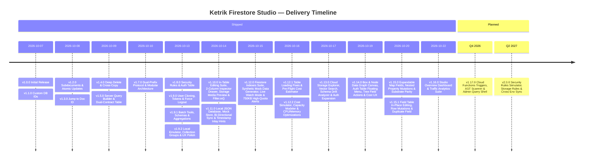

# Ketrik Firestore Studio — Product Roadmap & Release Schedule

This document outlines the version milestones, historical release dates, and strategic roadmap for **Ketrik Firestore Studio**.

---

## 📅 Release History & Milestones

| Version | Status | Release Date | Key Focus Areas |
| :--- | :--- | :--- | :--- |
| **v1.0.0** | Shipped | 2026-10-07 | Multi-connection explorer, virtual JSON editor, basic collection tables |
| **v1.1.0** | Shipped | 2026-10-07 | Named custom database IDs (`(default)` and custom instances), UI badges |
| **v1.1.1** | Shipped | 2026-10-07 | Paging offset fixes, gRPC connection handling |
| **v1.2.0** | Shipped | 2026-10-08 | Root variables as virtual subdocuments, atomic partial updates, tree fields |
| **v1.2.1** | Shipped | 2026-10-08 | Modal QuickPick for booleans/numbers/strings, tree sync fixes |
| **v1.3.0** | Shipped | 2026-10-08 | Direct 1-read document ID jump (Tree & Table views), quota protection |
| **v1.4.0** | Shipped | 2026-10-09 | Deep recursive delete, duplicate doc, cross-connection copy/paste, memory cleanups |
| **v1.5.0** | Shipped | 2026-10-09 | Server-side query builder (multi-clause `where`), Map/Array field table view (`openFieldAsTable`), atomic field rename, granular refresh |
| **v1.7.0** | Shipped | 2026-10-10 | Dual-Prefix protocol (`_` & `__`), Tree hierarchy badging, Table column zones & noise toggles, protocol query presets, safe mode mutation guards, cross-substrate paste, modular extension architecture |
| **v1.8.0** | Shipped | 2026-10-13 | Live Security Rules inspector & diff (`firestore.rules`), TextMate syntax grammar, AST rule permissions parser, Firebase Auth users tree & table view (bulk load, newest-first sort, custom claims editor, profile linker), sticky table columns (pinned ID & actions) |
| **v1.9.0** | Shipped | 2026-10-13 | Cross-environment user cloning (`cloneAuthUser`), custom token minter (`mintCustomToken` / login as user), session revocation (`revokeUserSessions` / force logout), password reset link generator, cascade profile deletion, user avatar photos in table, clean icon-only rule badges |
| **v1.9.1** | Shipped | 2026-10-13 | Batch operations (`WriteBatch` update/delete), TypeScript contract & Zod generator, CSV/JSON/NDJSON import & export wizard, collection `count()`/`sum()`/`avg()` aggregations, query bookmarks & history, create user dialog & auth security policies |
| **v1.9.2** | Shipped | 2026-10-13 | Local Firebase Emulator suite, collection group queries, inline table icons, aggregation QuickPick, rule caching |
| **v1.10.0** | Shipped | 2026-10-14 | In-table spreadsheet editing suite (in-cell primitives, 2-column Key-Value Property Drawer for Maps/Arrays, atomic `FieldPath` updates), Bulk Field Deletion Checklist (`deleteMultipleFields`), inline hover trash icon (`$(trash)`), Cloud Storage media preview, DocumentReference jump, disjunctive queries (`Filter.or()`), starts-with operator |
| **v1.11.0** | Shipped | 2026-10-14 | Local JSON Database & Mock Store, cross-instance collection copy (`copyCollectionToInstance`), bi-directional sync (Push/Seed & Pull Snapshot), document storage size monitoring & status bar, timestamp formatting & inlay hints, table batch load controls (+50, +100, Load All 1K cap) & auto-replenish |
| **v1.12.0** | Shipped | 2026-10-15 | Firestore Composite Indexes Suite (tree inspector, firestore.indexes.json 2-way sync & auto-fixer), Synthetic Mock Data Generator (schema inference, 400 docs/batch), Real-Time Live Watch Mode (onSnapshot with animated flash feedback), 750KB High-Quota Warning Indicators |
| **v1.12.1** | Shipped | 2026-10-16 | Collection table loading fixes, Cost & Quota explorer tree item, unified Status Bar Cloud Monitoring metrics, query pre-flight cost estimator |
| **v1.12.2** | Shipped | 2026-10-16 | Interactive Cost Simulator dashboard, capacity modeling, comprehensive CPU & memory optimizations |
| **v1.13.0** | Shipped | 2026-10-17 | Cloud Storage Explorer, Vector Search (kNN), Collection Schema Drift & Anomaly Analyzer, Firebase Auth Expansion & Document Auto-Reveal |
| **v1.14.0** | Shipped | 2026-10-19 | Interactive Box & Node Data Graph Canvas, Auth Table Floating Menu (`⋯`), Document Tree Inline Field Actions, Responsive Cost & Quota UX |
| **v1.15.0** | Shipped | 2026-10-20 | Recursive expandable Map field nodes in Explorer Tree, context-aware nested property mutations, scoped multi-property deletions, field clipboard parity (Copy as JSON, nested dotted paths), arbitrary dot-delimited paths in virtual filesystem & Local JSON |
| **v1.15.1** | Shipped | 2026-10-20 | Field Table in-place spreadsheet cell editing, row entry addition & deletion, Duplicate Field command (`ketrik-firestore-studio.duplicateField`), and shared webview table styles |
| **v1.16.0** | Shipped | 2026-10-22 | Unified Studio Overview Dashboard, Database & User Insights, Network & Traffic Analytics Suite, Storage Footprint & Quota Burn Rate Gauges |
| **v1.17.0** | Planned | Q4 2026 | Cloud Functions Trigger Scanner (⚡), Trigger Simulation, Live Logs & Admin Query Shell |
| **v2.0.0** | Future | Q2 2027 | Interactive Security Rules simulator & test runner, Cloud Storage security rules (`storage.rules`), cross-environment data & schema diff viewer |

---

## 🚀 Active & Upcoming Releases

### [v1.8.0] — Security Rules & Auth User Management (Shipped: 2026-10-13)

*Theme: Project governance, security rules diffing, enterprise user claims, and high-density tabular browsing.*

* **Live Security Rules Inspector & Diff (`firestore.rules`)**:
  * Direct extraction of live deployed rules via Firebase Rules API (`firebase.securityRules.get`).
  * Virtual editor tab (`ketrik-firestore-studio://rules/firestore.rules`) with `.rules` syntax highlighting.
  * Side-by-side graphical diff between deployed cloud rules and local workspace `firestore.rules`.
  * Quick deployment command with safety confirmation.
  * AST permission analysis highlighting locked vs authenticated collections.
* **Firebase Authentication & User Management Suite**:
  * Dedicated **Authentication (Users & Claims)** tree node under each connection.
  * Tree paging (25 users/batch) with `Load more users...` cursor pagination.
  * **Auth Users Webview Table**:
    * Bulk loading up to 1,000 users per single HTTP request (zero Firestore read billing).
    * Instant in-memory sorting by **Creation Date (Newest First)**, **Last Sign-in**, and **Email / Name**.
    * Real-time client-side filter by email, UID, display name, and custom claims.
    * In-table actions: Edit Custom Claims (`admin`, roles), Check/Create Firestore Profile (`users/{uid}`), and Disable/Enable user.
    * Export loaded/filtered users to JSON.
* **Sticky Column Table Navigation**:
  * Sticky left-pinned identifier columns (`Document ID`, `Email / Name`, `Row ID`) during horizontal scroll.
  * Sticky right-pinned `Actions` column on Auth Users Table.
  * Sticky column headers on vertical scroll.

---

### [v1.9.0] — User Cloning, Token Minter & Session Control (Shipped: 2026-10-13)

*Theme: Cross-environment user migration, impersonation token minting, and clean tree ergonomics.*

* **Cross-Environment Auth User Cloning (`ketrik-firestore-studio.cloneAuthUser`)**:
  * Clone any user account directly across connections (e.g. *Production $\rightarrow$ Staging* or *Local Emulator*).
  * Copies account metadata (`uid`, `email`, `displayName`, `photoURL`, `phoneNumber`, `disabled`, `emailVerified`) and custom claims.
  * Option to simultaneously clone their associated Firestore profile document (`/users/{uid}`).
  * Automatically copies a freshly generated password reset link for the target environment to the clipboard.
* **Custom Auth Token Minter (`ketrik-firestore-studio.mintCustomToken`)**:
  * 1-click minting of signed custom JWT auth tokens for any user (`auth.createCustomToken(uid)`).
  * Enables instant login as any user in client frontends or REST testing to verify security rules and app permissions.
* **Session Revocation / Force Logout (`ketrik-firestore-studio.revokeUserSessions`)**:
  * Immediately revokes all active refresh tokens for an account across all sessions and devices.
* **Password Reset Link Generator (`ketrik-firestore-studio.resetAuthUserPassword`)**:
  * Generates secure out-of-band password reset links directly from tree context menus or table rows, copied straight to clipboard with optional browser jump.
* **Cascade User & Profile Deletion (`ketrik-firestore-studio.deleteAuthUser`)**:
  * Delete an Auth user with intelligent prompt to also delete their `/users/{uid}` Firestore profile document.
* **Avatar & Photo Display in Auth Users Table**:
  * Renders user profile avatars (`photoURL`) with automated fallback to stylized user initial badges.
* **Ergonomic Icon-Only Security Badges**:
  * Replaced bulky text badges in the tree view with minimal single-character status icons (`🚨`, `⚠️ 🌐`, `👤`, `🛡️`, `🔑`, `🔒`), preserving full readable analysis inside hover tooltips.

---

### [v1.9.1] — Data Power Tools, TypeScript Schema & Aggregations (Shipped: 2026-10-13)

*Theme: Eliminating repetitive data wrangling, adding native Firestore count/sum aggregations, and giving TypeScript developers instant type definitions.*

* **Multi-Document Batch Operations in Table View (`WriteBatch`)**:
  * Multi-select rows in Collection Table via sticky checkbox column.
  * Batch field update (update a single field, atomic `FieldValue.delete()`, or merge JSON payload across selected documents via chunked `WriteBatch`).
  * Batched delete with confirmation modal showing count of affected documents, total write operations, and safety confirmation.
* **Native Firestore Aggregations (`count()`, `sum()`, `avg()`)**:
  * Native Firestore `count()`, `sum()`, and `avg()` aggregation support in the Table view header.
  * Instant collection document count at ultra-low cost (1 read per 1,000 index entries) without downloading document bodies.
  * Calculate field sum and average directly from server aggregation on demand.
* **Intelligent TypeScript Interface & Zod Schema Generator**:
  * Right-click any collection or document $\rightarrow$ **Generate TypeScript / Zod Schema...**.
  * Introspects and samples $N$ documents (10–50), deducing merged keys, optional fields (`?`), union types, and converting Firestore types (`Timestamp`, `GeoPoint`, `DocumentReference`).
  * Generates pure TypeScript interfaces (`interface UserDoc { ... }`) or Zod schemas (`z.object({ ... })`).
  * Direct copy to clipboard, open in new editor, or write to `.d.ts` / `.ts` file in the workspace.
* **Data Import & Export Wizard (CSV, JSON & NDJSON)**:
  * Import CSV, JSON, or NDJSON datasets directly into a Firestore collection with custom document ID strategy (Auto-ID, specific property, or row index) and automated type coercion (ISO dates $\rightarrow$ Timestamps, numbers, booleans).
  * Chunked streaming via `WriteBatch` (400 writes/batch) with live progress bar and cancellation controls.
  * Full collection export to JSON, NDJSON, or CSV with progress reporting.
* **Query Bookmarks & Search History**:
  * Save frequently used server-side `where` query combinations as named bookmarks per collection.
  * Stored in workspace configuration (`.vscode/firestore-queries.json`) for team sharing via Git.
  * Quick-access saved queries dropdown list in the table toolbar.
* **Firebase Auth Suite Enhancements**:
  * Create Auth User Dialog (`ketrik-firestore-studio.createAuthUser`): scaffold new user accounts directly in VS Code (email, password, displayName, custom claims).
  * Project Auth Security & Policies inspector (`ketrik-firestore-studio.inspectProjectAuthConfig`): inspect password policies, email privacy protection, MFA factor IDs, and SMS region policies.

---

### [v1.9.2] — Local Emulator Suite, Collection Groups & UI/UX Polish (Shipped: 2026-10-13)

*Theme: Frictionless local development, cross-hierarchy querying, ergonomic table actions, and rendering stability.*

* **Workspace & Local Emulator Auto-Discovery & Integrated Launcher**:
  * Automatically parse workspace `firebase.json` and `.firebaserc` to detect projects and configured emulators (Firestore `8080`, Auth `9099`, UI `4000`).
  * Non-blocking socket port health probing (`net.Socket`) with live status bar indicator (`$(server-process) Emulator: 8080 (Online)`).
  * 1-Click integrated terminal launcher (`firebase emulators:start`) with active port polling, timeout protection, and automatic connection provisioning.
  * Interactive QuickPick status menu (`ketrik-firestore-studio.emulatorStatusMenu`): Start, Stop, Restart, Connect, Open Emulator UI, and Re-scan.
  * Cross-substrate Auth emulator integration (`FIREBASE_AUTH_EMULATOR_HOST`) keeping production and emulator connections cleanly isolated.
  * Welcome view quick-action to boot or connect local emulators when no connections are present.
* **Collection Group Queries (`collectionGroup`)**:
  * Dedicated "Query Collection Group..." command (`ketrik-firestore-studio.queryCollectionGroup`) on connection, collection context menus, and Command Palette.
  * Partition-wide `firestore.collectionGroup(id)` querying flattening all subcollections across the database into a single tabular view.
  * Sticky **Parent Document** column (`__parentPath`) displaying origin document hierarchy with 1-click jump to open parent documents in VS Code.
  * Full server-side `where` filtering, sorting, cursor-based `startAfter` paging, batch operations (`WriteBatch`), and native `count()`/`sum()`/`avg()` aggregations.
  * Composite index error catcher with 1-click jump to Firebase Console index builder when queries require a collection-group-scoped index.
* **Inline Table View Action Icons in Tree Explorer**:
  * Inline `$(table)` action icon on collections for instant 1-click table view opening.
  * Inline `$(table)` action icon on Map and Array document fields (`openFieldAsTable`).
* **Smart Aggregations & Numeric QuickPick**:
  * `calcAggBtn` (`∑ Aggregates...`) only appears when numeric fields are detected in the loaded documents.
  * Interactive QuickPick automatically lists all detected numeric fields with custom path fallback.
  * Responsive loading (`⏳ Calculating...`) and error recovery states on the aggregation button.
* **Security Rules AST Caching & Safe Fallback**:
  * In-memory cache for parsed AST security rules (`RulesParser.ts`) eliminating redundant evaluation latency.
  * Graceful handling when no rules file is downloaded or configured, preventing misleading locked/restricted badges.
* **Table View Reliability & UX Polish**:
  * Fixed initial blank collection table view with recursive `sanitizeFirestoreValue()` and client script compatibility.
  * Fixed sticky column hover opacity bleed-through using opaque themed backgrounds.
  * Contextual toolbar buttons (`__ Protocol`, `_ Envelope`, `Simulate Time`) and clean empty state view.

---

### [v1.10.0] — In-Table Editing Suite, Drawer Inspector & Storage Previews (Shipped: 2026-10-14)

*Theme: Interactive spreadsheet-like data mutation, 2-column complex object inspector, rich media inspection, and advanced query composition.*

* **In-Table Spreadsheet Editing Suite (Primitives)**:
  * Direct in-place cell editing for scalar fields (strings, numbers, booleans, timestamps, nulls) via double-click or `Enter`/`F2`.
  * Keyboard spreadsheet navigation (`Tab`, `Shift+Tab`, `Arrow keys`).
  * Type-preserving atomic field updates via `docRef.update(new FieldPath(field), value)` with instant UI flash feedback and live virtual filesystem cache invalidation (`invalidateAndNotify`).
  * Document opening decoupled: clicking the Document ID link or dedicated `📄` action opens the virtual JSON file.
* **Slide-out Property Inspector Drawer (2-Column Key:Value for Maps & Arrays)**:
  * Double-clicking or clicking any complex Map or Array cell slides out a focused right-hand drawer (500px wide, zero horizontal scrolling).
  * **2-Column Property Grid**:
    * Left column: Property Key (editable) or Array Index `[0]`.
    * Right column: In-place type-safe input, boolean switches, and sub-object chips.
    * Row actions: Add Property (`➕`), delete property (`🗑️`).
  * **Dual Modes**: 1-click toggle between interactive **Property Grid** and **Raw JSON** textarea with real-time bidirectional syncing.
  * **Escape Hatch (`↗ Open as Table`)**: 1-click jump from the drawer to open the Map/Array in the multi-column `openFieldAsTable` substrate view.
* **Cloud Storage In-Field Media Preview**:
  * Automatic detection of Storage download URLs (`https://firebasestorage.googleapis.com/...`) and `gs://` paths in table cells and document JSON.
  * Interactive image thumbnails with hover-zoom, audio waveform playback, video preview, and PDF badge.
* **DocumentReference Interactive Navigation**:
  * Visual badge for `DocumentReference` fields in table view and tree view with clickable jump to open target document.
  * Preview hover tooltip showing referenced document excerpt without opening.
* **Disjunctive Queries (`Filter.or()` and `Filter.and()`)**:
  * Multi-group query builder supporting `OR` logic between filter sets in the Table view.
* **Prefix / `starts-with` String Filter Helper**:
  * GUI operator compiling `starts-with "prefix"` to `>= "prefix" && < "prefix\uf8ff"`.

---

### [v1.11.0] — Local JSON Database, Seed Store & Bi-Directional Firestore Sync (Shipped: 2026-10-14)

*Theme: Zero-quota local development, mock dataset playground, offline-first tabular editing, and friction-free seed data promotion.*

* **Direct Local JSON File / Folder Database Connections**:
  * **New Connection Type**: Connect directly to a single local JSON file (`mock-db.json`) or a directory of collection JSON files (`./seed-data/*.json`).
  * Dedicated connection badge and icon `$(file-code)` in the Explorer Tree.
  * Auto-discovers top-level keys as **Collections**, children as **Documents**, and sub-keys as **Fields**.
  * Fully offline — operates without requiring Google Cloud credentials, internet access, or the Java Firebase Local Emulator process.
* **Full Parity in Virtual Document Editor & Webview Tables**:
  * Open local JSON documents in the virtual JSON editor (`ketrik-firestore-studio://local/...`) with real-time in-place disk persistence on save.
  * Open any local collection in the **Interactive Collection Table**: in-place spreadsheet cell editing, 2-column Property Grid drawer for Maps/Arrays, client-side sorting, and full-text search.
  * Tree explorer field mutation parity: rename fields, delete fields, add fields, and convert nulls/timestamps directly in the local file.
* **Bi-Directional Firestore Data Sync Suite**:
  * **Push / Seed to Firestore (`ketrik-firestore-studio.pushToFirestore`)**:
    * Right-click local JSON collection or document $\rightarrow$ **"Push / Seed to Firestore..."**.
    * Target connection picker: select any cloud Firestore or local emulator connection.
    * Collision handling options: *Merge / Patch*, *Overwrite*, or *Skip Existing*.
    * Batch writes (`WriteBatch`, 400 docs/batch) with live progress indicator and cancellation controls.
  * **Pull / Snapshot from Firestore (`ketrik-firestore-studio.snapshotToLocalJson`)**:
    * Right-click live Firestore collection $\rightarrow$ **"Snapshot to Local JSON Store"**.
    * Choose whether to update an existing local JSON store connection or generate a new standalone dataset file.
* **Direct 1-Click Cross-Instance Collection Copy (`ketrik-firestore-studio.copyCollectionToInstance`)**:
  * Right-click any collection (live Cloud Firestore, Emulator, or Local JSON) $\rightarrow$ select **"Copy Collection to Another Instance..."**.
  * Seamless cross-instance cloning (e.g. *Production $\rightarrow$ Staging*, *Staging $\rightarrow$ Emulator*, or clone under a new name).
  * Chunked batch writes (400 docs/batch) with live progress bar, cancellation controls, and collision handling (*Merge / Patch* vs *Overwrite*).
* **Document Storage Size Monitoring & 1MB Quota Safety**:
  * Real-time calculation of exact Firestore document storage sizes conforming strictly to official Google Cloud Firestore specifications.
  * **Tree View Size Badges**: Each document displays its exact size badge (`e.g. 1.4 KB`, `240 B`) with visual warning indicators (`⚡ 820 KB`, `⚠️ 1,010 KB`) and rich hover tooltips detailing byte count, path, and percentage of the 1MB Firestore limit.
  * **Status Bar Item (`Firestore Document Size`)**: When a Firestore document (virtual or local JSON) is active in the editor, displays real-time live size in the VS Code Status Bar with dynamic warning/error color styling and breakdown tooltip.
* **Table View Batch Load Controls & Quota Safety Cap**:
  * Added quick-load action buttons to collection tables: **`+50`**, **`+100`**, and **`Load All (Max 1,000)`** alongside the default **`Load More`**.
  * Dynamic backend paging expansion strictly capped at a hard maximum safety limit of 1,000 documents to prevent accidental runaway reads or billing spikes.
  * Real-time button disablement, dynamic loading labels (`Loading 100...`), smooth scrolling, and amber highlight animations on bulk append.
* **Intelligent Table Auto-Replenish on Deletion**:
  * Deleting documents in the Table View now automatically queries and loads the next set of documents up to the count of deleted items when additional collection documents exist, eliminating blank empty states.
* **Frictionless Document Creation**:
  * Creating documents (from Explorer Tree or Table View) now pre-populates `{}` by default, allowing users to simply press **Enter** without manual typing.
* **Interactive Timestamp & Type Revival for Local JSON**:
  * Automatic detection and parsing of `{ _seconds, _nanoseconds }` maps in JSON files, showing calendar icons and human-readable dates.
  * Inlay Hints and Hover explanations directly in local JSON files.

---

### [v1.12.0] — Firestore Indexes Suite, Synthetic Data & Live Watch (Shipped: 2026-10-15)

*Theme: Zero-friction Firestore composite index governance, schema-driven synthetic mock data generation, backend trigger visibility, and real-time event streaming.*

* **Firestore Indexes Management & Diagnostics Suite**:
  * **Dedicated "Composite Indexes" Explorer Node**:
    * New top-level branch under each connection alongside Root Collections and Authentication.
    * Live tree nodes for each collection / collection group index displaying fields, sort orders (`ASC` / `DESC`), query scope (`COLLECTION` vs `COLLECTION_GROUP`), and live deployment status (`SERVING`, `BUILDING / CREATING`, `NEEDS_REPAIR`).
    * Direct actions: Delete Index, inspect definition, and trigger re-index.
  * **Two-Way Synchronization with `firestore.indexes.json`**:
    * **Pull / Snapshot Live Cloud Indexes**: 1-click import of all currently deployed cloud indexes directly into the workspace `firestore.indexes.json` configuration file.
    * **Side-by-Side Graphical Diff**: Compare deployed cloud indexes against local workspace definitions before deploying changes.
    * **1-Click Cloud Deployment**: Deploy local index definitions directly to the active Firestore instance using the Google Cloud Firestore Admin REST API.
  * **Missing Composite Index Auto-Fixer & 1-Click Builder**:
    * Intercepts `FAILED_PRECONDITION` index required errors in Collection Tables, Collection Group queries, and Server Query Builder.
    * Automatically parses the required index field specification from the error and offers **"Append to firestore.indexes.json"** and **"Create in Background via API"**, eliminating manual browser console navigation.
  * **Interactive Visual Index Builder GUI**:
    * Modal form to construct multi-field composite indexes with drag-and-drop field ordering, ASC/DESC toggles, and Array-Contains support.
    * Manage single-field overrides (exemption rules, TTL policies, and vector index configurations).
* **Synthetic Mock Data Generator (`ketrik-firestore-studio.generateSyntheticData`)**:
  * **Intelligent Schema Deduction & Sampling**:
    * Right-click any collection (Cloud Firestore, Local Emulator, or Local JSON) $\rightarrow$ **"Generate Synthetic Data..."**.
    * Analyzes existing collection documents to infer field names, nesting structures, and value distributions.
  * **Realistic Domain-Aware Mock Generators**:
    * Automatic type detection and realistic synthesis:
      * **Personal Data**: Full names, usernames, realistic avatar URLs, phone numbers.
      * **Contact & Auth**: RFC-compliant fake emails, UIDs, and password hashes.
      * **Commerce & Finance**: Currencies, prices (min/max bounded), order IDs, credit card masks.
      * **Location**: Geographic coordinates (`GeoPoint`), street addresses, country codes.
      * **Timestamps**: Past/future relative dates, created/updated intervals.
      * **Relational / Foreign Keys**: Automatic sampling of existing document IDs in other collections to synthesize valid `DocumentReference` links.
  * **Interactive Generation Wizard & Preview**:
    * Configurable generation count: e.g. 10, 50, 100, 500, or custom up to 2,000 documents.
    * Document ID strategy: Auto-ID (random 20-character Firestore ID), sequential index (`user_001`), or custom field slug (`slug-from-name`).
    * In-editor JSON preview of 3 sample generated documents before committing writes.
  * **Safe Chunked Ingestion & Offline Seeding**:
    * Chunked `WriteBatch` execution (400 docs/batch) with live progress bar and cancellation.
    * Target flexibility: Seed directly into Cloud Firestore, Local Firebase Emulator, or export as a local mock JSON database file.
* **Cloud Functions Trigger AST Scanner & In-Tree Badges (⚡)**:
  * Automatically scan workspace `functions/` directory for declared Firestore triggers (`onDocumentCreated`, `onDocumentUpdated`, `onDocumentDeleted`, `onDocumentWritten` in v2, and `onCreate`, `onUpdate`, etc. in v1).
  * Display an animated **Trigger Badge ⚡** on collection and document nodes with 1-click jump to function TypeScript source code.
* **Simulate Cloud Function Triggers on Document**:
  * Right-click any document $\rightarrow$ **"Simulate Cloud Function Trigger..."** (`onCreate`, `onUpdate`, `onDelete`).
  * Packages document snapshot into standard `CloudEvent` / `Change<DocumentSnapshot>` format and dispatches directly to local Firebase Functions Emulator (`http://localhost:5001`).
* **Live Cloud Function Execution Logs Filter**:
  * Right-click collection or document $\rightarrow$ stream GCP Cloud Logging or emulator logs filtered by target document or collection.
* **Interactive JS/TS Admin SDK Query Shell (`.firestore.ts`)**:
  * Scaffold a virtual scratchpad file with authenticated `db`, `auth`, `admin`, and `FieldValue` in scope.
  * Run ad-hoc migrations or queries with `Cmd+Enter` and output streaming to an in-editor terminal panel.
* **Live Watch Mode / Real-Time Event Feed (`onSnapshot`)**:
  * Live Sync toggle (`📡 Live Watch`) on Collection Tables and open document editors with animated mutation feedback (green flash for new, amber for updated, red for deleted).
  * Quota safety: auto-pause watchdog after 5 minutes of inactivity.
* **Query Performance Profiler & Index Auto-Fixer (`explain({ analyze: true })`)**:
  * Visual query plan displaying execution latency, index entries scanned, and billable reads.
  * 1-click extraction of missing composite index URLs directly into workspace `firestore.indexes.json`.

---

### [v1.12.1] — Table Loading Fixes & Quota Governance Suite (Shipped: 2026-10-16)

*Theme: Webview stability, query cost transparency, and real-time Google Cloud Monitoring status bar sync.*

* **Collection Table Webview Reliability & State Retention**:
  * Fixed table client-side event parser syntax error (`msg.type === 'fieldUpdateFailed'`) that caused document grid loading to hang on initial open.
  * Enabled `retainContextWhenHidden: true` on collection table webviews to preserve pagination, active filters, search text, and scroll position when switching between editor tabs.
  * Synchronized webview HTML initialization to guarantee instant document queries upon tab focus.
* **Cost & Quotas Tree Navigation**:
  * Added top-level **"Cost & Quotas"** item under every Firestore connection in the Explorer sidebar tree (`CostQuotaBranchItem` with `$(graph)` icon).
  * Direct 1-click launcher for the interactive **Cost Simulator & Quota Usage Dashboard**.
* **Unified Status Bar Quota Indicator**:
  * Unified status bar reads indicator to reflect true 24-hour cloud usage from Google Cloud Monitoring REST API (`firestore.googleapis.com/document/read_count`) alongside current session in-memory delta.
  * Automatically switches active connection context based on the document currently focused in the editor (`ketrik-firestore-studio://<connId>/...`).
* **Pre-Flight Query Cost Estimator (`estimateQueryCost`)**:
  * Added **"💰 Estimate Cost"** action button in Collection Table server-side query builder.
  * Uses a lightweight single-read `count()` server aggregation to project read counts and estimated Blaze billable cost ($0.06 / 100K reads) with warning badges if queries exceed free quota limits.

---

### [v1.12.2] — Cost Simulator, Capacity Modeler & CPU/Memory Optimizations (Shipped: 2026-10-16)

*Theme: Interactive cost modeling, capacity planning simulations, and comprehensive CPU and memory tuning.*

* **Interactive Firestore Cost Simulator & Capacity Modeler (`ketrik-firestore-studio.openCostSimulator`)**:
  * **Daily Free Allowance Tracking & Progress Meters**:
    * Full integration of standard Google Cloud / Firebase Free Tier daily quotas (50K reads, 20K writes, 20K deletes, 1 GiB storage, 10 GiB egress).
    * Real-time progress bars showing daily % consumed before Blaze billing kicks in.
  * **Live Cloud Usage Retrieval (GCP Cloud Monitoring API)**:
    * Non-blocking background querying of Google Cloud Monitoring metrics (`firestore.googleapis.com/document/read_count`, `write_count`, `delete_count`).
    * Session operation counter with in-memory delta tracking and 1-click session reset.
    * Interactive historical charts with 7-day, 14-day, and 30-day time-series views.
  * **Architectural Scenario & What-If Modeling Tool**:
    * Visual calculator for capacity planning: inputs for DAU, operations per session, document size, retention policies, and client-side caching.
    * Live monthly Blaze cost projections and estimated caching ROI savings.
    * 1-Click export of simulation reports to Markdown or JSON.
* **Core Runtime & Webview Performance Optimizations**:
  * **Cloud Monitoring API Caching**: 120s TTL caching for daily monitoring metrics and 300s TTL for historical metrics in `CostService`.
  * **Status Bar & Webview Debouncing**: Debounced `CostStatusBarController` updates (1,000ms) with concurrency re-entrancy locks; debounced webview usage updates (500ms) and proper disposal on panel closure.
  * **Timestamp Editor Decorations**: Fast $O(1)$ early substring check and 50-entry LRU cache in `TimestampEditorDecorations`, eliminating redundant regex and JSON parsing on editor hover/scrolls; freed on document close.
  * **Zero-Allocation ASCII Fast-Path**: Zero-allocation ASCII loop in `getUtf8ByteLength` eliminating V8 C++ boundary crossings during document storage size calculation.
  * **Real-Time Live Watch DOM Batching**: Batched `liveWatchEvent` DOM updates using `requestAnimationFrame` to eliminate UI layout thrashing, and batch `DocumentFileSystemProvider.invalidateAndNotifyMany`.
  * **Local JSON Disk Caching**: In-memory `_fileCache` in `LocalJsonService` with `mtimeMs` validation to avoid repeated disk reads, plus batch atomic writes for collection copying, syncing, and seeding.
  * **Safe Mode Field Operations**: Added Local JSON support and `FieldPath` dot-notation safety to `deleteMultipleFieldsCommand`, plus `CostService.recordOperation` tracking across all field commands.
  * **Emulator Config Watcher**: 300ms debounce to eliminate port probing socket bursts on workspace file changes.

---

### [v1.13.0] — Storage Explorer, Vector Search & Schema Analyzer (Shipped: 2026-10-17)

*Theme: Cloud Storage bucket exploration, vector similarity search (kNN), automated schema drift analysis, and Firebase Auth expansion.*

* **Dedicated Cloud Storage Explorer in Sidebar Tree**:
  * Dedicated **Cloud Storage** branch under each connection (`StorageBucketsBranchItem`): browse buckets, folders, files, MIME types, file sizes, and download URLs.
  * Drag-and-drop file upload into document fields (auto-uploads to bucket and writes resulting URL or `gs://` path).
  * Signed URL minter (`ketrik-firestore-studio.mintSignedUrl` / `getSignedUrl`) with customizable expiry (15m, 1h, 24h).
  * Cascade orphan file cleanup prompt when deleting documents or Auth users.
  * File inspection modal, delete file action, and 1-click clipboard copy for `gs://` and HTTPS URLs.
* **Firebase Auth Suite Expansion**:
  * Email verification link (`ketrik-firestore-studio.generateEmailVerificationLink`) and passwordless sign-in link (`ketrik-firestore-studio.generateSignInWithEmailLink`) generators.
  * Bulk Auth user import/export wizard (`ketrik-firestore-studio.importAuthUsersWizard`: JSON/CSV with SCRYPT, BCRYPT, PBKDF2 hash support).
  * Provider identity chips (`Google`, `GitHub`, `Apple`, `Phone`, `Password`, `Anonymous`) and provider-based filtering.
  * Enrolled Multi-Factor Authentication (MFA) second factors viewer (`ketrik-firestore-studio.viewUserMfa`).
* **Firestore Vector Search & Embeddings Explorer (kNN)**:
  * Dedicated column renderer for `VectorValue` fields showing dimension count and cosine magnitude preview.
  * Similarity search query builder: execute kNN queries (`findNearest`) with vector inputs, distance metric (`COSINE`, `EUCLIDEAN`, `DOT_PRODUCT`), and similarity scores per row (`__vector_distance` badge column).
  * In-place vector inspection drawer and full Local JSON client-side kNN calculation fallback.
  * Quick-picker support for adding and editing `FieldValue.vector` embeddings directly from tree context menus.
* **Collection Schema Drift & Anomaly Analyzer (`ketrik-firestore-studio.analyzeCollectionSchema`)**:
  * Scans collection sample to produce interactive visual health reports: field presence percentages, type consistency matrix, and orphan keys.
  * In-table toolbar launcher (`🔬 Schema Health`) and Tree context menu action (`Analyze Schema Drift & Anomalies...`).
  * Instant filter pills (`Anomalies & Warnings`, `Mixed Types`, `Orphan Keys`, `100% Present`) and 1-click export to Markdown or JSON.
* **Auto-Reveal Document in Tree View**:
  * Added setting `ketrik-firestore-studio.autoRevealDocumentInTree` (default: `true`) and toolbar action (`ketrik-firestore-studio.revealActiveDocumentInTree`).
  * Automatically reveals, expands to, and highlights documents in the Explorer Tree View when opened from collection table views or editor tabs.

---

### [v1.14.0] — Data Graph Canvas, Auth Context Menu & Tree Field Actions (Shipped: 2026-10-19)

*Theme: Interactive node-graph data visualization (hybrid SVG+HTML canvas), responsive single-instance Auth context menus, document tree field actions, and responsive cost/quota views.*

* **Interactive Box & Node Data Graph Canvas (Hybrid SVG + HTML Architecture)**:
  * **Dual-Layer Canvas Engine**:
    * **SVG Relationship Layer**: High-DPI crisp Bézier curves (`<path d="...">`), directional arrow markers (`<marker id="arrow">`), dashed lines for weak references, and animated particle flows for real-time mutations.
    * **HTML Structured Node Layer**: Rich DOM box cards for Collections, Documents, and Subcollections with CSS flexbox layout, type chips, and scalar previews.
    * **Unified Pan & Zoom Transform**: Synchronized coordinate matrix (`transform: translate(x, y) scale(k)`) supporting infinite canvas exploration (`0.2x` to `3.0x` zoom).
  * **DocumentReference & Subcollection Link Discovery**:
    * Automatically traces and draws directed edges for Firestore `DocumentReference` fields (`[Ref: path]`), subcollection parent-child trees, and foreign key path strings.
    * Expandable/collapsible node ports: click a document's outgoing reference port to expand and fetch referenced documents on demand with single-read quota protection.
  * **Interactive Node Box Controls**:
    * Header badges with collection color coding and document ID copy link.
    * In-box preview of top scalar fields with 1-click jump to open the document in the virtual JSON editor tab or collection table.
    * Mini-map navigator and auto-layout engine (hierarchical Dagre-style or force-directed graph alignment).
* **Firebase Auth Table Single-Instance Context Menu (`⋯`)**:
  * **Ultra-Compact Action Column**: Replaced the sprawling row of 9 horizontal action buttons with a single compact `⋯` icon button per row.
  * **Zero DOM Explosion**: Single floating context dialog element rendered once on `<body>` and positioned on click via `getBoundingClientRect()`, eliminating thousands of redundant button allocations on large 1,000-user tables.
  * **Responsive & Small-Screen Resilient**: Eliminates button overflow, text clipping, and inaccessible actions on narrow windows or split-screen editor panes.
  * Dynamic action availability reflecting user state (*Disable/Enable User*, *Verify Email Link*, *Passwordless Sign-In*, *Mint Token*, *Clone User*, *Edit Claims*, *Delete Profile*).
* **Explorer Tree Document Interaction & Granular Refresh**:
  * Added inline `+` button directly on document nodes in the tree to quickly add fields without opening the full context menu.
  * Two-phase click: single-click expands fields; clicking an already expanded document opens the virtual JSON editor tab.
  * Fixed field deletion tree refresh to locate and reload the parent document node immediately.
* **Cost & Quota Simulator Visual Enhancements**:
  * Distinct amber styling for **Active Session Accounting** and green styling for **Live Cloud Monitoring**.
  * Discrete warning notice banner with exact error reasons when Cloud Monitoring is unreachable, plus inline **"Try Again"** button.
  * Responsive layout for narrow screens and split panes with horizontal tab scrolling and button grid wrapping.

---

### [v1.15.0] — Expandable Map Fields, Nested Property Mutations & Clipboard Parity (Shipped: 2026-10-20)

*Theme: Recursive Map field tree hierarchy, context-aware nested property mutations, scoped batch property deletion, full JSON clipboard parity, and dot-path virtual filesystem resolution.*

* **Recursive Expandable Map Field Nodes in Explorer Tree**:
  * Complex Map fields (`{ n keys }`) with `keyCount > 0` are now first-class collapsible tree items (`vscode.TreeItemCollapsibleState.Collapsed`). Empty objects (`{}`) remain non-collapsible (`None`).
  * **Zero-Quota Browsing**: Expanding a Map field yields child `DocumentFieldItem` instances recursively without consuming any extra Firestore document reads (data is resolved in memory from the parent document snapshot).
  * **Two-Phase Click Behavior**: When collapsed, clicking expands the branch; once expanded, single-clicking opens the field in the virtual JSON editor tab (`ketrik-firestore-studio://.../docPath.json?field=address`).
  * **Parent Hierarchy Navigation**: Seamless tree reveal and `getParent` resolution back to the parent map or document node.
* **Context-Aware "Add Nested Property..." on Map Fields**:
  * Dedicated nested property creation command (`ketrik-firestore-studio.addNestedProperty`) targeting Map fields directly.
  * Inline `$(add)` quick action button on Map field tree rows and context menu action.
  * Prompts for new property name with input validation and full type picker (String, Number, Boolean, Timestamp, GeoPoint, Map, Array, Custom JSON).
  * Atomic Firestore writes via `docRef.update(new FieldPath(...targetSegments), value)` without touching sibling map keys.
* **Scoped "Delete Multiple Properties..." for Maps**:
  * Context-aware batch property deletion (`ketrik-firestore-studio.deleteMultipleFields`): when invoked on a Map field, scopes the QuickPick checklist strictly to the properties inside that specific map.
  * Safe Mode warnings and confirmation modal when system envelope (`_`) or protocol (`__`) keys are selected.
  * Multi-key atomic Firestore deletion using `FieldValue.delete()` across all selected nested paths in a single write operation.
* **Field Clipboard Parity ("Copy as JSON" & Nested Dotted Paths)**:
  * Dedicated **"Copy as JSON"** command (`ketrik-firestore-studio.copyFieldJson`) on all field context menus, copying clean formatted JSON representation of field values to the clipboard.
  * Enhanced **"Copy Path"** command (`ketrik-firestore-studio.copyPath`) to copy complete dot-delimited paths for nested fields (e.g. `users/123/address.street`) and enabled for all field types.
* **Arbitrary Dot-Delimited Path Support in Virtual File System & Local JSON**:
  * Enhanced `DocumentFileSystemProvider` (`getNestedFieldValue`): `stat`, `readFile`, baseline hash conflict detection, and `writeFile` now cleanly resolve and mutate arbitrarily nested property paths via `new FieldPath(...segments)`.
  * Enhanced `LocalJsonService` to support deep dotted path traversal and atomic mutations for offline JSON connections.

---

### [v1.15.1] — Field Table In-Place Editing, Row Mutations & Duplicate Field (Shipped: 2026-10-20)

*Theme: Spreadsheet in-place editing for Map/Array tables, row entry additions/deletions, and field duplication.*

* **Field Table In-Place Spreadsheet Editing**:
  * Double-click or Enter/F2 on scalar cells (strings, numbers, booleans, timestamps, nulls) in `openFieldAsTable` to edit values directly in place.
  * Type-safe inputs with boolean dropdowns, number validation, and optimistic `.flash-update` animation.
  * Atomic Firestore partial writes via `FieldPath(...segments, rowId, field)` for Maps and in-memory element replacement for Arrays with live `invalidateAndNotify` cache syncing.
* **Field Table Entry Addition (`➕ Add Entry`)**:
  * Dedicated toolbar action in Field Table to add new keyed properties to Maps or append elements to Arrays.
  * Interactive type picker (String, Number, Boolean, Timestamp, Object, Array, Custom JSON) with input validation.
* **Field Table Row Deletion (`🗑️ Delete Entry`)**:
  * Per-row action button (`🗑️`) with confirmation dialog.
  * Atomically deletes Map keys via `FieldValue.delete()` or splices Array elements by index.
* **Duplicate Field Command (`ketrik-firestore-studio.duplicateField`)**:
  * Right-click any field or nested property in the Explorer Tree to clone it under a new key.
  * Automatic collision checking, custom name prompt, and atomic write-back.

---

### [v1.16.0] — Studio Overview Dashboard & Traffic Analytics Suite (Shipped: 2026-10-22)

*Theme: Unified database & user insights, network traffic & throughput monitoring, and operational dashboards.*

* **Unified Studio Overview & Insights Dashboard (`ketrik-firestore-studio.openOverviewDashboard`)**:
  * **Database & Collection Breakdown**:
    * Total collection count, document counts via server-side `count()` aggregations, and estimated dataset storage volume.
    * Top 5 largest collections by document volume with 1-click jump to Table View.
  * **Network & Traffic Analytics Suite**:
    * **Throughput & Operations**: Interactive time-series charts showing hourly and 7-day/30-day reads, writes, and deletes.
    * **Bandwidth & Payload Size**: Sent bytes (egress) vs. received bytes (ingress) over time to spot oversized documents or query payload spikes (`firestore.googleapis.com/network/sent_bytes_count`).
    * **Real-Time Client Connections**: Active real-time listeners (`onSnapshot`) tracking client load (`firestore.googleapis.com/listen/realtime_connections_count`).
    * **Security Rule Traffic**: Allowed vs. Denied rule evaluation traffic ratio (`firestore.googleapis.com/rules/evaluation_count`).
    * **Multi-Source Fallback**: Automatically pulls from Google Cloud Monitoring API, Local Emulator telemetry ports, or active Studio session accounting with zero disruption.
  * **Firebase Auth & Growth Insights**:
    * Total registered users, 7-day sign-in frequency, and unverified vs. verified accounts.
    * Provider distribution breakdown (Email/Password, Google, Apple, Anonymous, Phone).
  * **Storage & Quota Gauges**:
    * Visual sparklines comparing current daily burn rate against Spark (Free) allowances and Blaze thresholds.

---

### [v1.17.0] — Cloud Functions Triggers, Logs Filter & Admin Query Shell (Target: Q4 2026)

*Theme: Deep Cloud Functions developer tooling, Firestore trigger simulation, live logging, and in-editor Admin SDK scratchpads.*

* **Cloud Functions Trigger AST Scanner & In-Tree Badges (⚡)**:
  * Automatically scan workspace `functions/` directory for declared Firestore triggers (`onDocumentCreated`, `onDocumentUpdated`, `onDocumentDeleted`, `onDocumentWritten` in v2, and `onCreate`, `onUpdate`, etc. in v1).
  * Display an animated **Trigger Badge ⚡** on collection and document nodes with 1-click jump to function TypeScript source code.
* **Simulate Cloud Function Triggers on Document**:
  * Right-click any document $\rightarrow$ **"Simulate Cloud Function Trigger..."** (`onCreate`, `onUpdate`, `onDelete`).
  * Packages document snapshot into standard `CloudEvent` / `Change<DocumentSnapshot>` format and dispatches directly to local Firebase Functions Emulator (`http://localhost:5001`).
* **Live Cloud Function Execution Logs Filter**:
  * Right-click collection or document $\rightarrow$ stream GCP Cloud Logging or emulator logs filtered by target document or collection.
* **Interactive JS/TS Admin SDK Query Shell (`.firestore.ts`)**:
  * Scaffold a virtual scratchpad file with authenticated `db`, `auth`, `admin`, and `FieldValue` in scope.
  * Run ad-hoc migrations or queries with `Cmd+Enter` and output streaming to an in-editor terminal panel.
* **Local Offline SQLite Cache & Mocking Mode (Zero-Quota Development)**:
  * Snapshot working sets to a local SQLite database for zero-cost offline development without needing the Java Firebase Local Emulator.
  * Visual sync manager upon reconnecting with conflict resolution (Keep Remote, Overwrite, Merge).

---

### [v2.0.0] — Security Rules Simulator, Storage Rules & Cross-Env Sync (Target: Q2 2027)

*Theme: True enterprise governance, multi-service security rules simulation, and cross-project promotion.*

* **Interactive Security Rules Simulator & Test Runner**:
  * In-IDE simulation engine to test rules against mock request auth tokens (`request.auth.uid`, `request.auth.token.role`) and mock resource payloads before deploying.
  * Line-by-line visual AST evaluation showing exact pass/fail boolean branches.
  * 1-Click export of simulation scenarios as `@firebase/rules-unit-testing` Jest/Mocha test files.
* **Cloud Storage Security Rules Inspector & Diff (`storage.rules`)**:
  * Live extraction via Firebase Rules API, syntax highlighting, and side-by-side graphical diff between deployed cloud rules and workspace `storage.rules`.
* **Cross-Environment Data & Schema Diff Viewer (Staging vs. Production)**:
  * Side-by-side graphical diff between connections (comparing collections, schemas, or specific config documents).
  * 1-Click selective promotion/sync of documents from Staging to Production with diff preview and confirmation.
* **Local Offline Cache & Mocking Mode (Zero-Quota Development)**:
  * Snapshot working sets to a local SQLite database for zero-cost offline development on flights/commutes without needing the Java Firebase Local Emulator.
  * Visual sync manager upon reconnecting with conflict resolution (Keep Remote, Overwrite, Merge).
* **Unified Multi-Tab Studio Dashboard**:
  * Unified workspace tab integrating Collections, Auth Users, Rules, Storage Buckets, and Metrics.

