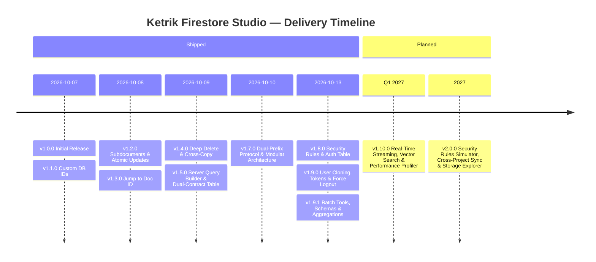

# Ketrik Firestore Studio — Product Roadmap & Release Schedule

This document outlines the version milestones, historical release dates, and strategic roadmap for **Ketrik Firestore Studio**.

---

## 📅 Release History & Milestones

| Version | Status | Release Date | Key Focus Areas |
| :--- | :--- | :--- | :--- |
| **v1.0.0** | Shipped | 2026-10-07 | Multi-connection explorer, virtual JSON editor, basic collection tables |
| **v1.1.0** | Shipped | 2026-10-07 | Named custom database IDs (`(default)` and custom instances), UI badges |
| **v1.1.1** | Shipped | 2026-10-07 | Paging offset fixes, gRPC connection handling |
| **v1.2.0** | Shipped | 2026-10-08 | Root variables as virtual subdocuments, atomic partial updates, tree fields |
| **v1.2.1** | Shipped | 2026-10-08 | Modal QuickPick for booleans/numbers/strings, tree sync fixes |
| **v1.3.0** | Shipped | 2026-10-08 | Direct 1-read document ID jump (Tree & Table views), quota protection |
| **v1.4.0** | Shipped | 2026-10-09 | Deep recursive delete, duplicate doc, cross-connection copy/paste, memory cleanups |
| **v1.5.0** | Shipped | 2026-10-09 | Server-side query builder (multi-clause `where`), Map/Array field table view (`openFieldAsTable`), atomic field rename, granular refresh |
| **v1.7.0** | Shipped | 2026-10-10 | Dual-Prefix protocol (`_` & `__`), Tree hierarchy badging, Table column zones & noise toggles, protocol query presets, safe mode mutation guards, cross-substrate paste, modular extension architecture |
| **v1.8.0** | Shipped | 2026-10-13 | Live Security Rules inspector & diff (`firestore.rules`), TextMate syntax grammar, AST rule permissions parser, Firebase Auth users tree & table view (bulk load, newest-first sort, custom claims editor, profile linker), sticky table columns (pinned ID & actions) |
| **v1.9.0** | Shipped | 2026-10-13 | Cross-environment user cloning (`cloneAuthUser`), custom token minter (`mintCustomToken` / login as user), session revocation (`revokeUserSessions` / force logout), password reset link generator, cascade profile deletion, user avatar photos in table, clean icon-only rule badges |
| **v1.9.1** | Shipped | 2026-10-13 | Batch operations (`WriteBatch` update/delete), TypeScript contract & Zod generator, CSV/JSON/NDJSON import & export wizard, collection `count()`/`sum()`/`avg()` aggregations, query bookmarks & history, create user dialog & auth security policies |
| **v1.10.0** | Planned | Q1 2027 | Live watch mode (`onSnapshot` real-time feed), composite index auto-fixer (`firestore.indexes.json`), query performance profiler (`explain({ analyze: true })`), Firestore vector search (kNN), schema drift analyzer |
| **v2.0.0** | Future | 2027 | In-IDE Security Rules simulator & test runner, cross-environment data & schema diff viewer (Staging vs Prod), local offline cache & mocking, Firebase Cloud Storage explorer, multi-tab studio dashboard |

---

## 🚀 Active & Upcoming Releases

### [v1.9.0] — User Cloning, Token Minter & Session Control (Shipped: 2026-10-13)

*Theme: Cross-environment user migration, impersonation token minting, and clean tree ergonomics.*

* **Cross-Environment Auth User Cloning (`ketrik-firestore-studio.cloneAuthUser`)**:
  * Clone any user account directly across connections (e.g. *Production $\rightarrow$ Staging* or *Local Emulator*).
  * Copies account metadata (`uid`, `email`, `displayName`, `photoURL`, `phoneNumber`, `disabled`, `emailVerified`) and custom claims.
  * Option to simultaneously clone their associated Firestore profile document (`/users/{uid}`).
  * Automatically copies a freshly generated password reset link for the target environment to the clipboard.
* **Custom Auth Token Minter (`ketrik-firestore-studio.mintCustomToken`)**:
  * 1-click minting of signed custom JWT auth tokens for any user (`auth.createCustomToken(uid)`).
  * Enables instant login as any user in client frontends or REST testing to verify security rules and app permissions.
* **Session Revocation / Force Logout (`ketrik-firestore-studio.revokeUserSessions`)**:
  * Immediately revokes all active refresh tokens for an account across all sessions and devices.
* **Password Reset Link Generator (`ketrik-firestore-studio.resetAuthUserPassword`)**:
  * Generates secure out-of-band password reset links directly from tree context menus or table rows, copied straight to clipboard with optional browser jump.
* **Cascade User & Profile Deletion (`ketrik-firestore-studio.deleteAuthUser`)**:
  * Delete an Auth user with intelligent prompt to also delete their `/users/{uid}` Firestore profile document.
* **Avatar & Photo Display in Auth Users Table**:
  * Renders user profile avatars (`photoURL`) with automated fallback to stylized user initial badges.
* **Ergonomic Icon-Only Security Badges**:
  * Replaced bulky text badges in the tree view with minimal single-character status icons (`🚨`, `⚠️ 🌐`, `👤`, `🛡️`, `🔑`, `🔒`), preserving full readable analysis inside hover tooltips.

---

### [v1.8.0] — Security Rules & Auth User Management (Shipped: 2026-10-13)

*Theme: Project governance, security rules diffing, enterprise user claims, and high-density tabular browsing.*

* **Live Security Rules Inspector & Diff (`firestore.rules`)**:
  * Direct extraction of live deployed rules via Firebase Rules API (`firebase.securityRules.get`).
  * Virtual editor tab (`ketrik-firestore-studio://rules/firestore.rules`) with `.rules` syntax highlighting.
  * Side-by-side graphical diff between deployed cloud rules and local workspace `firestore.rules`.
  * Quick deployment command with safety confirmation.
  * AST permission analysis highlighting locked vs authenticated collections.
* **Firebase Authentication & User Management Suite**:
  * Dedicated **Authentication (Users & Claims)** tree node under each connection.
  * Tree paging (25 users/batch) with `Load more users...` cursor pagination.
  * **Auth Users Webview Table**:
    * Bulk loading up to 1,000 users per single HTTP request (zero Firestore read billing).
    * Instant in-memory sorting by **Creation Date (Newest First)**, **Last Sign-in**, and **Email / Name**.
    * Real-time client-side filter by email, UID, display name, and custom claims.
    * In-table actions: Edit Custom Claims (`admin`, roles), Check/Create Firestore Profile (`users/{uid}`), and Disable/Enable user.
    * Export loaded/filtered users to JSON.
* **Sticky Column Table Navigation**:
  * Sticky left-pinned identifier columns (`Document ID`, `Email / Name`, `Row ID`) during horizontal scroll.
  * Sticky right-pinned `Actions` column on Auth Users Table.
  * Sticky column headers on vertical scroll.

---

### [v1.9.1] — Data Power Tools, TypeScript Schema & Aggregations (Shipped: 2026-10-13)

*Theme: Eliminating repetitive data wrangling, adding native Firestore count/sum aggregations, and giving TypeScript developers instant type definitions.*

* **Multi-Document Batch Operations in Table View (`WriteBatch`)**:
  * Multi-select rows in Collection Table via sticky checkbox column.
  * Batch field update (update a single field, atomic `FieldValue.delete()`, or merge JSON payload across selected documents via chunked `WriteBatch`).
  * Batched delete with confirmation modal showing count of affected documents, total write operations, and safety confirmation.
* **Native Firestore Aggregations (`count()`, `sum()`, `avg()`)**:
  * Native Firestore `count()`, `sum()`, and `avg()` aggregation support in the Table view header.
  * Instant collection document count at ultra-low cost (1 read per 1,000 index entries) without downloading document bodies.
  * Calculate field sum and average directly from server aggregation on demand.
* **Intelligent TypeScript Interface & Zod Schema Generator**:
  * Right-click any collection or document $\rightarrow$ **Generate TypeScript / Zod Schema...**.
  * Introspects and samples $N$ documents (10–50), deducing merged keys, optional fields (`?`), union types, and converting Firestore types (`Timestamp`, `GeoPoint`, `DocumentReference`).
  * Generates pure TypeScript interfaces (`interface UserDoc { ... }`) or Zod schemas (`z.object({ ... })`).
  * Direct copy to clipboard, open in new editor, or write to `.d.ts` / `.ts` file in the workspace.
* **Data Import & Export Wizard (CSV, JSON & NDJSON)**:
  * Import CSV, JSON, or NDJSON datasets directly into a Firestore collection with custom document ID strategy (Auto-ID, specific property, or row index) and automated type coercion (ISO dates $\rightarrow$ Timestamps, numbers, booleans).
  * Chunked streaming via `WriteBatch` (400 writes/batch) with live progress bar and cancellation controls.
  * Full collection export to JSON, NDJSON, or CSV with progress reporting.
* **Query Bookmarks & Search History**:
  * Save frequently used server-side `where` query combinations as named bookmarks per collection.
  * Stored in workspace configuration (`.vscode/firestore-queries.json`) for team sharing via Git.
  * Quick-access saved queries dropdown list in the table toolbar.
* **Firebase Auth Suite Enhancements**:
  * Create Auth User Dialog (`ketrik-firestore-studio.createAuthUser`): scaffold new user accounts directly in VS Code (email, password, displayName, custom claims).
  * Project Auth Security & Policies inspector (`ketrik-firestore-studio.inspectProjectAuthConfig`): inspect password policies, email privacy protection, MFA factor IDs, and SMS region policies.

---

### [v1.10.0] — Real-Time Streaming, Vector Search & Performance Profiling (Target: Q1 2027)

*Theme: Real-time reactive data, vector similarity search, query indexing intelligence, and performance execution profiling.*

* **Live Watch Mode / Real-Time Event Feed (`onSnapshot`)**:
  * Live Sync toggle (`📡 Live Watch`) on Collection Tables and open document editors.
  * Subscribes via Firestore `onSnapshot` with subtle animated visual feedback on incoming changes (green flash for newly added docs, amber flash for modified fields, red strike-through for deleted docs).
  * Real-time event log drawer showing chronological mutation ticker with timestamps.
  * Quota safety: automatically pauses after 5 minutes of inactivity or configurable threshold.
* **Composite Index Intelligence & 1-Click Auto-Fixer**:
  * Automatically catches `FAILED_PRECONDITION: The query requires an index` errors from the Query Builder.
  * Parses Firebase Console URL to extract collection ID, query fields, and sort orders.
  * 1-Click action to append formatted composite index definition into workspace `firestore.indexes.json` for deployment via `firebase deploy --only firestore:indexes`.
  * 1-Click jump to exact Firebase Console index builder.
* **Query Performance Profiler & Cost Estimator (`explain({ analyze: true })`)**:
  * Integration with Firestore Explain API (`query.explain({ analyze: true })`).
  * "Explain Query Plan" button in Query Builder displaying execution latency, documents read vs index entries scanned efficiency ratio, and billable read count breakdown.
* **Firestore Vector Search & Embeddings Explorer (kNN)**:
  * Dedicated column renderer for `VectorValue` fields showing dimension count (e.g. `[1536 dims]`) and cosine magnitude preview.
  * Similarity search query builder: execute kNN queries (`findNearest`) with vector inputs, distance metric (`COSINE`, `EUCLIDEAN`, `DOT_PRODUCT`), and similarity scores per row.
* **Collection Schema Drift & Anomaly Analyzer**:
  * Scans collection sample to produce interactive visual health reports: field presence percentages, type consistency matrix (flagging mixed string/timestamp fields), and orphan keys.

---

### [v2.0.0] — Enterprise Studio, Cross-Environment Sync & Security Rules Engine (Target: 2027)

*Theme: True enterprise governance, local offline zero-cost emulation, rules simulation, and cross-service ecosystem integration.*

* **Interactive Security Rules Simulator & Test Runner**:
  * In-IDE simulation engine to test rules against mock request auth tokens (`request.auth.uid`, `request.auth.token.role`) and mock resource payloads before deploying.
  * Line-by-line visual AST evaluation showing exact pass/fail boolean branches.
  * 1-Click export of simulation scenarios as `@firebase/rules-unit-testing` Jest/Mocha test files.
* **Cross-Environment Data & Schema Diff Viewer (Staging vs. Production)**:
  * Side-by-side graphical diff between connections (comparing collections, schemas, or specific config documents like `/config/app_settings`).
  * 1-Click selective promotion/sync of documents from Staging to Production with diff preview and confirmation.
* **Local Offline Cache & Mocking Mode (Zero-Quota Development)**:
  * Snapshot working sets to a local SQLite database for zero-cost offline development on flights/commutes without needing the Java Firebase Local Emulator.
  * Visual sync manager upon reconnecting with conflict resolution (Keep Remote, Overwrite, Merge).
* **Firebase Cloud Storage Explorer**:
  * Dedicated **Storage Buckets** tree view under each connection.
  * In-line media preview for images, audio, video, and PDFs directly in VS Code.
  * Signed URL minter with configurable expiration.
  * Drag-and-drop file upload with automatic generation of Firestore `gs://` paths.
* **Unified Multi-Tab Studio Dashboard**:
  * Unified workspace tab integrating Collections, Auth Users, Rules, Storage Buckets, and Metrics.

